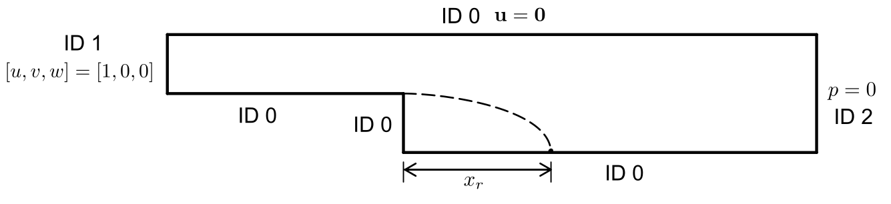
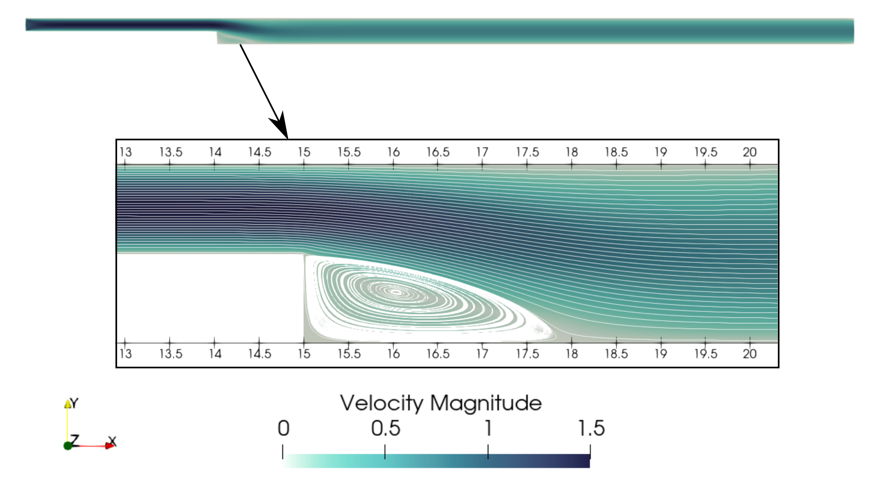
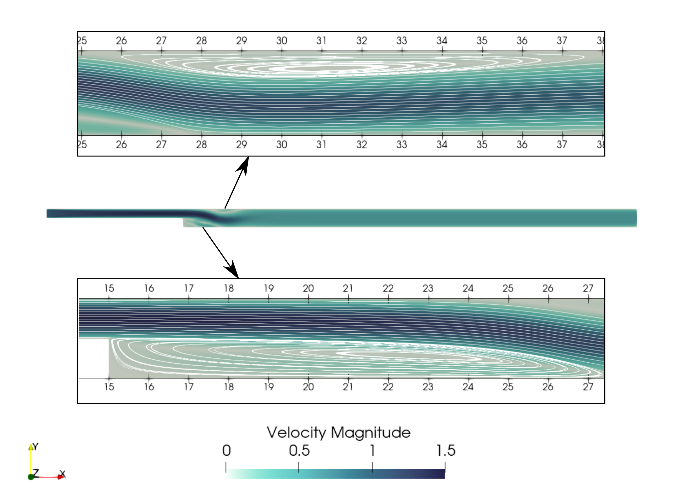
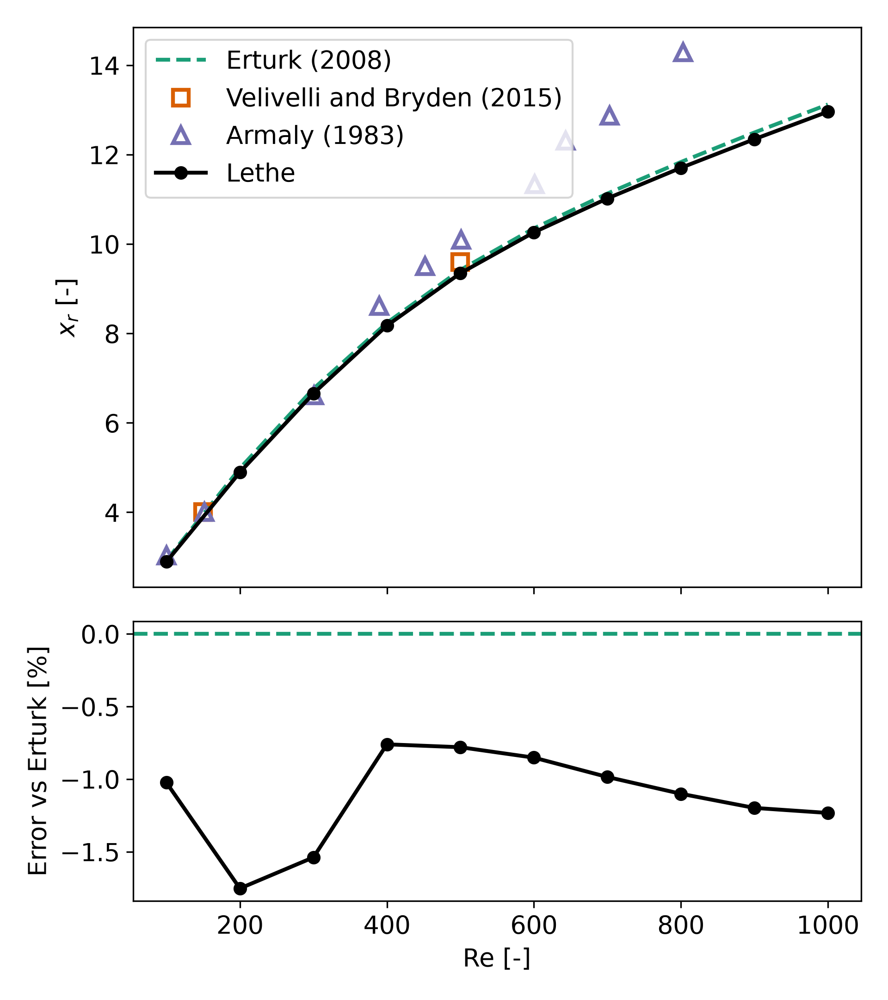

====================================
Flow past a Backward-Facing Step
====================================

--------
Features
--------

- Solver: ``lethe-fluid`` (with Q1-Q1)
- Steady-state solution obtained by a continuation on the kinematic viscosity
- Comparison with benchmark solutions for Reynolds numbers between 100 and 1000
- Mesh adaptation and error analysis
- Automated parametric sweep on the Reynolds number with Python scripts

----------------------------
Files Used in This Example
----------------------------

All files mentioned below are located in the example's folder (``examples/incompressible-flow/2d-backward-facing-step``).

- Geometry file: ``backward-facing-step.geo``
- Mesh file: ``backward-facing-step.msh``
- Parameter file for the base case (:math:`\mathrm{Re} = 100`): ``Reynolds100/Reynolds100_steady.prm``
- Parameter file template for the Reynolds number sweep: ``backward-facing-step.tpl``
- Python script for generating the cases of the Reynolds number sweep: ``generate_cases_locally.py``
- Python script for launching the cases of the Reynolds number sweep: ``launch_lethe_locally.py``
- Postprocessing Python script for computing the reattachment length at :math:`\mathrm{Re} = 100`: ``reattachment_length.py``
- Postprocessing Python script for computing the reattachment length of the Reynolds number sweep: ``postprocess_reynolds_sweep.py``
- Benchmark data for the reattachment length: ``benchmark-data.txt``

-----------------------
Description of the Case
-----------------------

In this example, a bidimensional flow goes past a backward-facing step. The flow enters from the left inlet and separates from the bottom wall at the step, and then reattaches to it further downstream at a distance :math:`x_r` from the step.

The backward-facing step problem is a classical computational fluid dynamics problem. The fact that it features a non-trivial solution while maintaining simple geometry and boundary conditions makes this problem a good candidate for validation purposes as well as to test the robustness of a given CFD method. First, the parameters of the backward-facing step problem at :math:`\mathrm{Re} = 100` will be shown. The same parameters are then used for ten Reynolds numbers between :math:`\mathrm{Re} = 100` and :math:`\mathrm{Re} = 1000`, and the reattachment length is compared to numerical and experimental data.

--------------
Parameter File
--------------

The following subsections show the parameters used in the simulation at :math:`\mathrm{Re} = 100`. Except for the kinematic viscosity, they are the same for every Reynolds number of the sweep.

Simulation Control
~~~~~~~~~~~~~~~~~~

The solution is computed as a steady state by setting ``method`` to ``steady``:

.. code-block:: text

    subsection simulation control
      set method            = steady
      set number mesh adapt = 10
      set output name       = backward_facing_step_output
      set output frequency  = 1
    end

A mesh refinement analysis can be done with ``set number mesh adapt = 10``. By starting from a coarse mesh and by dynamically refining the mesh 10 times, the convergence of the reattachment length with the mesh can be observed. Every steady solution is used as the initial guess of the Newton solver on the next mesh.

Physical Properties
~~~~~~~~~~~~~~~~~~~

In this problem, the Reynolds number is defined as follows:

.. math::
	Re_{D_h} = \frac{u D_h}{\nu} = \frac{2uh}{\nu}

where :math:`u` is the mean velocity at the inlet, :math:`h` is the step height, :math:`D_h = 2h` is the characteristic length and :math:`\nu` the kinematic viscosity.

In addition, unit values of :math:`u` and :math:`h` are chosen in the goal of obtaining an adimensional problem.

.. math::
	Re_{D_h} = f(\nu) = \frac{2}{\nu}

Consequently, the physical properties are defined as follows:

.. code-block:: text

    subsection physical properties
      set number of fluids = 1
      subsection fluid 0
        set kinematic viscosity = 0.02 # Re = 2/nu = 100
      end
    end

The ``kinematic viscosity`` is the only parameter that changes with :math:`\mathrm{Re}`. For :math:`\mathrm{Re} = 100`, we set the kinematic viscosity to :math:`0.02`, while for :math:`\mathrm{Re} = 1000` it is set to :math:`0.002`.

Initial Conditions
~~~~~~~~~~~~~~~~~~

As the Reynolds number increases, the problem becomes progressively stiffer and the Newton solver fails to converge from a zero initial guess. The initial condition is therefore obtained by a continuation on the kinematic viscosity (``type = ramp``):

.. code-block:: text

    subsection initial conditions
      set type = ramp
      subsection ramp
        subsection kinematic viscosity
          set initial kinematic viscosity = 0.02
          set iterations                  = 8
          set alpha                       = 0.5
        end
      end
    end

The steady problem is first solved with a kinematic viscosity of :math:`0.02` (:math:`\mathrm{Re} = 100`), and the kinematic viscosity is then brought closer to its final value at every iteration of the ramp: :math:`\nu_{i+1} = \nu_i + \alpha (\nu - \nu_i)`. Every solution is the initial guess of the next one. At :math:`\mathrm{Re} = 100`, the ramp does not change the kinematic viscosity, but it allows the same parameters to be used for every Reynolds number.

Mesh
~~~~

.. code-block:: text

    subsection mesh
      set type               = gmsh
      set file name          = ../backward-facing-step.msh
      set initial refinement = 1
    end

The mesh features quadrilateral elements as well as unit step and inlet heights (:math:`h_{in}=h=1`). In that direction, the expansion ratio has been set to :math:`\beta=\frac{h_{out}}{h_{in}}=2` throughout the entirety of the simulations. The inlet is located 15 step heights upstream of the step and the outlet 50 step heights downstream of it. The Gmsh mesh is refined once (``initial refinement = 1``), so that the solution on the initial mesh, which drives the first mesh adaptation, is accurate enough.

Mesh Adaptation
~~~~~~~~~~~~~~~

In this example, the mesh adaptation algorithm is based on the Kelly error estimator applied on the velocity variable. This strategy is suitable here, since a fine mesh is required in the vicinity of the step while a coarser mesh is acceptable far way from it.

.. code-block:: text

    subsection mesh adaptation
      set variable             = velocity
      set type                 = adaptive
      set error estimator      = kelly
      set min refinement level = 1
      set fraction refinement  = 0.1
      set fraction coarsening  = 0
    end

At every mesh adaptation, 10% of the cells are refined and no cell is coarsened, so that the number of cells increases by approximately 30% at every adaptation. After the 10 adaptations, the mesh contains approximately 58,000 cells for every Reynolds number.

Post-processing
~~~~~~~~~~~~~~~

The reattachment length is computed from the velocity gradient on the bottom wall, which is written in the output files:

.. code-block:: text

    subsection post-processing
      set output velocity gradient = true
    end

FEM
~~~

In this example, the degree of the polynomial interpolation used for both velocity and pressure is set to one.

.. code-block:: text

    subsection FEM
      set pressure degree = 1
      set velocity degree = 1
    end

Boundary Conditions
~~~~~~~~~~~~~~~~~~~

As presented in the description of the case (see figure above), three different boundary conditions (or boundary IDs) are necessary to define this particular problem.

.. code-block:: text

    subsection boundary conditions
      set number = 3
      subsection bc 0
        set id   = 0
        set type = noslip
      end
      subsection bc 1
        set id   = 1
        set type = function
        subsection u
          set Function expression = 6*(y-1)*(2-y)
        end
        subsection v
          set Function expression = 0
        end
        subsection w
          set Function expression = 0
        end
      end
      subsection bc 2
        set id   = 2
        set type = outlet
      end
    end

First, ``subsection bc 0`` sets a Dirichlet boundary condition (or ``noslip``) at each wall where :math:`\mathbf{u}=\mathbf{0}.` With ``type = function`` in ``subsection bc 1``, the components :math:`u`, :math:`v` and :math:`w` of the velocity at the inlet can be set independently. The inlet channel extends from :math:`y=1` to :math:`y=2`, and the inlet velocity is the fully developed Poiseuille profile of this channel, :math:`u = 6(y-1)(2-y)`, whose mean velocity is 1.

The outflow boundary condition is considered a natural boundary condition (also known as the *do nothing* boundary condition) and it is used since we can consider the outlet to be very far from the step. In fact, this condition specifies :math:`p \rightarrow 0` or in other words, that the traction on the fluid equals zero. In *Lethe*, this particular boundary condition is denoted by ``outlet`` and it is specified for the boundary ID :math:`2`.

Non-linear Solver
~~~~~~~~~~~~~~~~~

The ``newton`` non-linear solver is used with a medium ``tolerance``. The maximum number of iterations is increased to 20, since the first solutions of the ramp can require more iterations at high Reynolds numbers.

.. code-block:: text

    subsection non-linear solver
      subsection fluid dynamics
        set verbosity      = verbose
        set tolerance      = 1e-6
        set max iterations = 20
      end
    end

Linear Solver
~~~~~~~~~~~~~

We use an ``amg`` preconditioner with an ILU smoother (``amg preconditioner ilu fill = 1``), which remains efficient on the finest meshes and at the highest Reynolds numbers:

.. code-block:: text

    subsection linear solver
      subsection fluid dynamics
        set verbosity                   = verbose
        set method                      = gmres
        set max iters                   = 500
        set max krylov vectors          = 500
        set relative residual           = 1e-4
        set minimum residual            = 1e-9
        set preconditioner              = amg
        set amg preconditioner ilu fill = 1
      end
    end

.. tip::
	It is important to note that the ``minimum residual`` of the linear solver is smaller than the ``tolerance`` of the nonlinear solver. The reader can consult the `Parameters Guide <https://chaos-polymtl.github.io/lethe/documentation/parameters/cfd/linear_solver_control.html>`_ for more information.

-----------------------
Running the Simulations
-----------------------

The simulation at :math:`\mathrm{Re} = 100` can be executed from the ``Reynolds100`` folder using the following command (assuming that the solver's location is in your PATH environment variable and you want to use ``j`` processes for parallel computations):

.. code-block:: text
  :class: copy-button

  mpirun -np j lethe-fluid Reynolds100_steady.prm

Reynolds Number Sweep
~~~~~~~~~~~~~~~~~~~~~

The ``backward-facing-step.tpl`` file is a template of the parameter file above, in which the kinematic viscosity is replaced by ``{{ kinematic_viscosity }}``. The cases of the sweep are generated with the `Jinja2 <https://jinja.palletsprojects.com/>`_ Python module by:

.. code-block:: text
  :class: copy-button

  python3 generate_cases_locally.py

This creates a folder ``reynolds_sweep/Re_XXXX`` with the parameter file ``backward-facing-step.prm`` for every Reynolds number of the benchmark of Erturk (2008) [#erturk2008]_ (:math:`\mathrm{Re} = 100, 200, \dots, 1000`). Other Reynolds numbers can be given with the ``-Re`` argument, for example ``python3 generate_cases_locally.py -Re 150 250``. The simulations are then launched with:

.. code-block:: text
  :class: copy-button

  python3 launch_lethe_locally.py -np j

which launches the simulations one after the other, each on ``j`` processes. The output of every simulation is written in the ``log`` file of its folder.

----------------------
Results and Discussion
----------------------

:math:`\mathrm{Re}=100`
~~~~~~~~~~~~~~~~~~~~~~~

After opening the file ``backward_facing_step_output.pvd`` with Paraview, the following results are observed:

It is possible to notice a lot of diffusion past the step. This phenomenon is coherent with what is known of the Navier-Stokes equations: the diffusivity term is inversely proportional to the Reynolds number. Most importantly, a small eddy adjacent to the step is clearly observable. Downstream of the step, the flow separates from the bottom wall and this recirculation zone ends at the reattachment point. It is also visually noticeable that :math:`x_r \simeq 2.9` (:math:`x \simeq 17.9`). With the Python module `PyVista <https://docs.pyvista.org/>`_, raw simulation data can be extracted (from the .vtu files) and this data can be used to compute :math:`x_r` numerically using the following equation:

.. math::
	\left[ \frac{du}{dy} \right]_{y=0} = 0

The ``velocity_gradient`` field is written in the ``.vtu`` files, and its :math:`xy` component is :math:`\frac{du}{dy}`. The postprocessing script samples this component along the bottom wall downstream of the step, for every mesh adaptation step. The wall shear is negative under the recirculation zone, and :math:`x_r` is the point where it becomes positive again at the end of this zone, found by linear interpolation between the sampling points. The script can be used with the following command:

.. code-block:: text
  :class: copy-button

  python3 reattachment_length.py

The final value of :math:`x_r` is :math:`2.892` with a relative error of :math:`1.0\%`.  The reference value used to compute the error is the one given by Erturk (2008) [#erturk2008]_.

:math:`\mathrm{Re}=1000`
~~~~~~~~~~~~~~~~~~~~~~~~

In a similar way as we did in the last subsection, for :math:`\mathrm{Re} = 1000` (case ``reynolds_sweep/Re_1000`` of the sweep) the results that can be visualized in Paraview are the following:

On the contrary of what we saw in the :math:`\mathrm{Re} = 100` case, it is clear that there is much less diffusion within the flow. This is once more coherent with the theory. The same eddy as mentioned in the previous section is still present but grows as the Reynolds number is increased. Furthermore, a second principal eddy can be seen adjacent to the top wall in the range :math:`x \in [25,37]`. This "oscillating flow" characteristic is expected of a higher Reynolds flow such as this one. Finally, the :math:`x_r` variable is evaluated visually at :math:`x_r \simeq 13.0` (:math:`x \simeq 28.0`). The postprocessing of the Reynolds number sweep (see below) gives :math:`x_r = 12.957` on the final mesh, with a relative error of :math:`1.2\%`.

Reynolds Number Sweep
~~~~~~~~~~~~~~~~~~~~~

The reattachment length on the final mesh of every case of the sweep is computed and compared with the benchmark data of ``benchmark-data.txt`` by running:

.. code-block:: text
  :class: copy-button

  python3 postprocess_reynolds_sweep.py

The reattachment length increases with the Reynolds number, and the results of Lethe agree with the numerical benchmark of Erturk (2008) [#erturk2008]_ within 1.8% for every Reynolds number, using approximately 58,000 cells. At high Reynolds numbers, a second recirculation zone appears on the top wall, but it does not affect the computation of the reattachment length on the bottom wall. The experimental results of Armaly *et al.* (1983) [#armaly1983]_ agree with the numerical results up to :math:`\mathrm{Re} \approx 300`. Above this Reynolds number, the flow in the experiment becomes three-dimensional, and the two-dimensional simulations predict a shorter reattachment length.

---------------------------
Possibilities for Extension
---------------------------

- **Validate with a 3D geometry/mesh**: Since experimental data takes into account 3D effects, it would be interesting to compare numerical data to experimental results.
- **Use second order elements for higher Reynolds simulations**: Using second order elements can improve accuracy for more turbulent flows. Also, it can be very powerful in this particular example, since quadratic elements can theoretically interpolate *Poiseuille* flows with genuinely no numerical error. Consequently, the method can yield incredibly precise results while maintaining a very coarse mesh far from the step.

----------
References
----------

.. [#erturk2008] \E. Erturk, “Numerical solutions of 2-D steady incompressible flow over a backward-facing step, Part I: High Reynolds number solutions,” *Comput. Fluids*, vol. 37, no. 6, pp. 633–655, Jul. 2008, doi: `10.1016/j.compfluid.2007.09.003 <https://doi.org/10.1016/j.compfluid.2007.09.003>`_\.

.. [#armaly1983] \B. F. Armaly, F. Durst, J. C. F. Pereira, and B. Schönung, “Experimental and theoretical investigation on backward-facing step flow,” *J. Fluid Mech.*, vol. 127, pp. 473–496, 1983, doi: `10.1017/S0022112083002839 <https://doi.org/10.1017/S0022112083002839>`_\.
