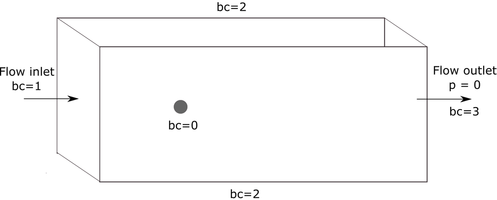
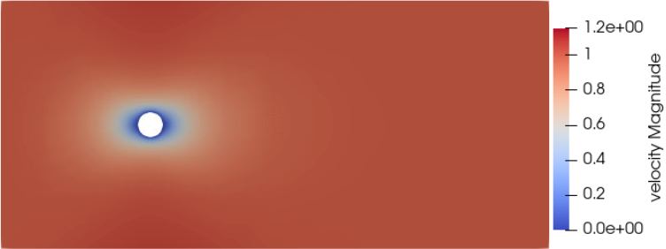
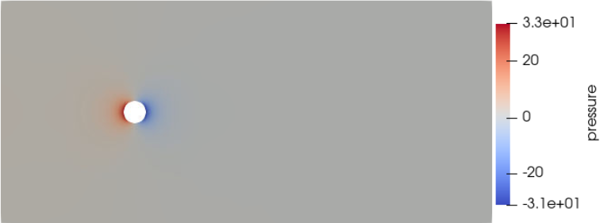
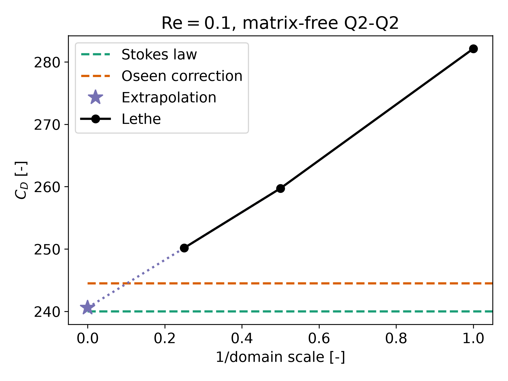
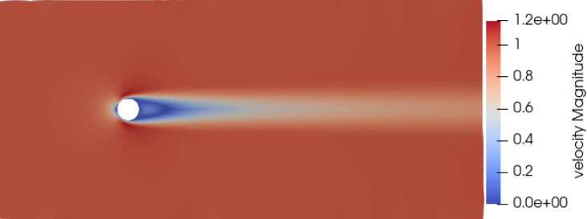
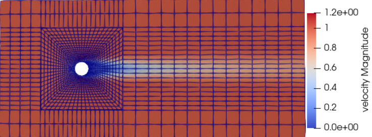
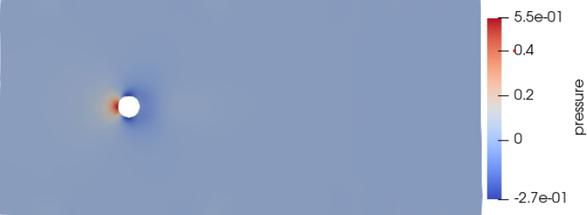
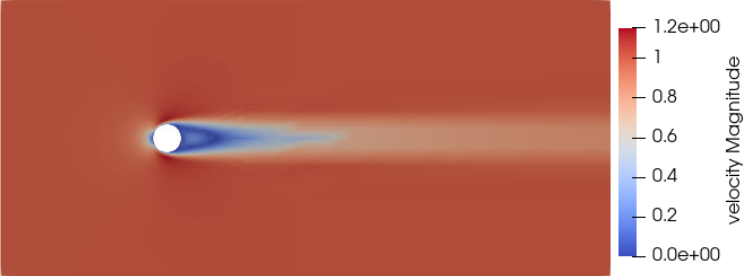
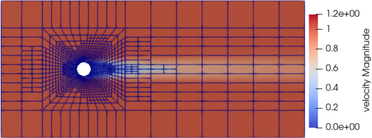

==================================
Flow around a Sphere
==================================

In this example, a fluid flows past a sphere.

----------------------------------
Features
----------------------------------

- Solvers: ``lethe-fluid`` or ``lethe-fluid-matrix-free``
- Steady-state problem
- Displays the importance of adaptive mesh refinement
- Displays the effect of the Reynolds number on the convergence

----------------------------
Files Used in This Example
----------------------------

All files mentioned below are located in the example's folder (``examples/incompressible-flow/3d-flow-around-sphere``).

- Parameter file for :math:`\mathrm{Re}=0.1`: ``sphere-0.1.prm``
- Parameter file for :math:`\mathrm{Re}=150`: ``sphere-150.prm``
- Parameter file for :math:`\mathrm{Re}=150` using adaptive mesh refinement: ``sphere-adapt.prm``
- Parameter files for the matrix-free solver: ``sphere-0.1-matrix-free.prm`` and ``sphere-150-matrix-free.prm``
- Parameter files for the matrix-free solver at :math:`\mathrm{Re}=0.1` on domains enlarged twice and four times: ``sphere-0.1-matrix-free-x2.prm`` and ``sphere-0.1-matrix-free-x4.prm``
- Postprocessing Python script for computing the drag coefficients: ``postprocess_drag.py``

-----------------------
Description of the Case
-----------------------

The following schematic describes the simulation and its boundary condition indices.

Note that the sphere surface has a boundary index of ``0``, the inlet ``1``, the walls parallel to the flow direction have a boundary index of ``2`` and the outlet an index of ``3``.

As this examples allows for two different Reynolds numbers as well as an adaptive mesh refinement variation, the parameter file section will specify the differences when applicable.

--------------
Parameter File
--------------

We first establish the parameters.

Mesh
~~~~

The structured mesh is built using `gmsh <https://gmsh.info/#Download>`_. Geometry parameters can be adapted in the "Variables" section of the .geo file, as shown below.

.. code-block:: text

  // Variables
  gr=4;             // Global refinement
  around=10;        // Refinement around the sphere
  trail=8;          // Refinement of trail of sphere
  near_sphere=1.20; // Progression of cell refinement to sphere surface
  // Scaling factor of the size of the domain (the size of the sphere and the
  // number of cells do not change). It can be changed from the command line:
  //   gmsh -setnumber domain_scale 2 -3 sphere.geo -o sphere-x2.msh
  If (!Exists(domain_scale))
    domain_scale=1;
  EndIf
  downstream=16*domain_scale;    // Length of domain downstream of sphere
  upstream=-6*domain_scale;      // Length of domain upstream of sphere (must be negative)
  cross_section=10*domain_scale; // Cross-sectional width/height
  radius=0.5;                    // Radius of sphere

.. note::

  The domain is constructed so that the wake has sufficient distance to develop downstream and there is a sufficient cross-sectional area to limit the effects of the boundary conditions on the flow at :math:`\mathrm{Re}=150`. At :math:`\mathrm{Re}=0.1`, the disturbance of the flow by the sphere decays much more slowly and the size of the domain has a significant impact on the drag coefficient. This is why the ``domain_scale`` variable can be used to enlarge the domain, as discussed in the results section.

In the parameter file, the mesh is read by specifying its type and file name:

.. code-block:: text

    subsection mesh
      set type               = gmsh
      set file name          = sphere.msh
      set initial refinement = 1
    end

.. note::

  The Gmsh mesh contains 5823 cells. For both static mesh cases (:math:`\mathrm{Re}=0.1` and :math:`\mathrm{Re}=150`), the ``initial refinement`` parameter is used and set to 1, so that it has a number of cells of the same magnitude as the mesh adaptation example. This mesh contains 46,584 cells.

Boundary Conditions
~~~~~~~~~~~~~~~~~~~

The ``boundary conditions`` subsection establishes the constraints on different parts of the domain. They are the same for all three parameter sets.

.. code-block:: text

    subsection boundary conditions
      set number = 4
      subsection bc 0
        set type = noslip
      end
      subsection bc 1
        set type = function
        subsection u
          set Function expression = 1
        end
        subsection v
          set Function expression = 0
        end
        subsection w
          set Function expression = 0
        end
      end
      subsection bc 2
        set type = slip
      end
      subsection bc 3
        set type = outlet
      end
    end

There are four boundary conditions, as shown in the figure above. A ``noslip`` condition is applied on the surface of the sphere, where the velocity should be 0. The inlet velocity is set to `u=1m/s`, and the boundaries of the domain that are parallel to the flow direction have a ``slip`` boundary condition. The outlet boundary condition also needs to be specified.

Physical Properties
~~~~~~~~~~~~~~~~~~~

This is where the parameters differ from the first and the two last examples.

Recall the definition of the Reynolds number for a flow past a sphere:

.. math::
 \mathrm{Re} = \frac{u_{\infty} D}{\nu}

Taking this into account and the fact that the sphere diameter :math:`D` is 1 m, and :math:`u_{\infty}` is set to 1 m/s, we set the ``kinematic viscosity`` parameter to obtain the targeted Reynolds number.

* In ``/examples/incompressible-flow/3d_flow_around_sphere/sphere-0.1.prm`` (Re = 0.1)

.. code-block:: text

    subsection physical properties
      subsection fluid 0
        set kinematic viscosity = 10
      end
    end

* In ``/examples/incompressible-flow/3d_flow_around_sphere/sphere-150.prm`` and ``/examples/incompressible-flow/3d_flow_around_sphere/sphere-adapt.prm`` (:math:`\mathrm{Re}=150`)

.. code-block:: text

    subsection physical properties
      subsection fluid 0
        set kinematic viscosity = 0.006666667
      end
    end

By default, simulations only contain a single fluid which is labeled ``0``.

FEM Interpolation
~~~~~~~~~~~~~~~~~

The default FEM parameters for this example use first degree polynomials. They can be easily changed to Q2-Q1 elements.

We specify the polynomial degree for both pressure and velocity using the ``FEM`` subsection:

.. code-block:: text

    subsection FEM
      set velocity degree = 1
      set pressure degree = 1
    end

Simulation Control
~~~~~~~~~~~~~~~~~~

The parameters also slightly differ from one problem to another the cases have different flow regimes.

In fact, for the :math:`\mathrm{Re} = 0.1`, we have a laminar to creeping flow, meaning that the flow is very steady, and therefore can be solved in steady-state.

.. code-block:: text

    subsection simulation control
      set method            = steady
      set number mesh adapt = 0
      set output path       = sphere-0.1/
      set output frequency  = 1
    end

At :math:`\mathrm{Re} = 150`, the flow has separated, resulting in an unstable wake and recirculation. It is hence more difficult to converge to a steady-state solution. Therefore we use different parameters:

.. code-block:: text

    subsection simulation control
      set method                         = steady_bdf
      set time step                      = 0.1
      set adapt time step to respect CFL = true
      set max cfl                        = 1000
      set stop tolerance                 = 1e-5
      set adaptative time step scaling   = 1.2
      set output path                    = sphere-150/
      set output frequency               = 1
    end

The ``steady_bdf`` method solves for a steady-state simulation using adjoint time stepping with a bdf1 scheme. An initial time step is used to complete a transient iteration, and with each iteration, the time step is increased. The simulation is considered to have reached steady-state when the L2 norm of the initial residual is lower than stop tolerance at the start of a non-linear solution step, i.e. until the time step is large enough that a pseudo-steady-state has been reached.

Initial Conditions
~~~~~~~~~~~~~~~~~~

An initial condition is used for the high Reynolds number problem. It is what we call a viscous initial condition that first finds a solution for the problem at :math:`\mathrm{Re} = 10` and then uses it as initial condition to find the solution at :math:`\mathrm{Re}=150`.

.. code-block:: text

    subsection initial conditions
      set type                = viscous
      set kinematic viscosity = 0.1
    end

Mesh Adaptation
~~~~~~~~~~~~~~~

To increase the accuracy of the drag coefficient, the mesh must be refined in areas of interest, such as on the front face of the sphere and in the developing wake. Therefore, adaptive mesh refinement is used to refine the mesh in such regions.

.. code-block:: text

    subsection mesh adaptation
      set type                 = adaptive
      set error estimator      = kelly
      set fraction coarsening  = 0.05
      set fraction refinement  = 0.1
      set fraction type        = number
      set max number elements  = 100000
      set min refinement level = 0
      set max refinement level = 4
      set variable             = pressure
      set frequency            = 5
    end

The mesh is dynamically adapted based on an estimate of the error of the solution for the pressure (the Kelly error estimator). The refinement is based on the number of elements. This means that the number of cells refined/coarsened per iteration is based on the fraction of the number of cells, rather than the fraction of the error (where all cells which have the fraction of the error are refined/coarsened).

The ``min refinement level`` refers to the base mesh which has been used in the previous static simulations. The mesh can only become finer than this, not coarser. The ``max refinement level`` is set at 3, giving a maximum possible number of cells of 3 million. However, the ``max number elements`` limits the number of cells to 50,000 to keep the simulation within feasible computational expense.

----------------------
Running the Simulation
----------------------

Launching the simulation is as simple as specifying the executable name and the parameter file. Assuming that the ``lethe-fluid`` executable is within your path, the simulation can be launched by typing:

.. code-block:: text
  :class: copy-button

  lethe-fluid sphere-0.1.prm

or

.. code-block:: text
  :class: copy-button

  lethe-fluid sphere-150.prm

or

.. code-block:: text
  :class: copy-button

  lethe-fluid sphere-adapt.prm

The two static mesh cases can also be simulated with the matrix-free solver:

.. code-block:: text
  :class: copy-button

  lethe-fluid-matrix-free sphere-0.1-matrix-free.prm
  lethe-fluid-matrix-free sphere-150-matrix-free.prm

These parameter files differ from the matrix-based ones in three ways: they use Q2-Q2 elements, the mesh is refined once (``initial refinement = 1``) and the linear system is preconditioned by a global coarsening hp-multigrid (``preconditioner = gcmg`` with ``mg coarsening type = hp``). The multigrid levels are first obtained by coarsening the mesh down to the Gmsh mesh, and then by decreasing the polynomial degree from 2 to 1. The coarse-grid problem is solved with an algebraic multigrid (``mg coarse grid solver = amg``). The results are written in the ``sphere-0.1-matrix-free`` and ``sphere-150-matrix-free`` folders.

To study the effect of the size of the domain at :math:`\mathrm{Re}=0.1`, the meshes of the domains enlarged twice and four times are generated with:

.. code-block:: text
  :class: copy-button

  gmsh -setnumber domain_scale 2 -3 sphere.geo -o sphere-x2.msh
  gmsh -setnumber domain_scale 4 -3 sphere.geo -o sphere-x4.msh

and the corresponding simulations are launched with:

.. code-block:: text
  :class: copy-button

  lethe-fluid-matrix-free sphere-0.1-matrix-free-x2.prm
  lethe-fluid-matrix-free sphere-0.1-matrix-free-x4.prm

-----------------------
Results and Discussion
-----------------------

First Case Results (:math:`\mathrm{Re}=0.1`)
~~~~~~~~~~~~~~~~~~~~~~~~~~~~~~~~~~~~~~~~~~~~

Using Paraview, the steady-state velocity profile and the pressure profile can be visualized by creating a *slice* along the xy-plane (z-normal) that cuts in the middle of the sphere (See `documentation <https://forgeanalytics.io/blog/creating-slices-in-paraview/>`_).

We can appreciate the axisymmetrical behavior of the flow. The drag on the sphere is available in the output file ``force.00.dat`` (the other force files ``force.01.dat``, ``force.02.dat``  and ``force.03.dat`` give the forces on the other boundary conditions 1, 2 and 3, respectively).

.. note::
  We only perform one iteration, therefore we only have one line in the force file. If several iterations are carried out by further refining the mesh several lines will be obtained. The last line of the file shows the force calculated in the last iteration. Since the flow is in the x-direction, the x-direction force ``f_x`` allows us to calculate the drag force.

.. code-block:: text

  cells      f_x            f_y           f_z          f_xv          f_yv          f_zv          f_xp          f_yp          f_zp
  46584 105.1156249119 -0.0000000602 -0.0000000392 67.6640027070 -0.0000000531 -0.0000000329 37.4516222050 -0.0000000071 -0.0000000063

The drag coefficient is :math:`C_D = \frac{2 F_x}{\rho u_{\infty}^2 A}`, where :math:`A = \pi D^2/4` is the frontal area of the sphere. Given the flow parameters, the calculated drag coefficient is 267.7. At :math:`\mathrm{Re}=0.1`, the flow is very close to a Stokes flow, for which the drag coefficient of a sphere in an infinite domain is given by Stokes law, :math:`C_D = 24/\mathrm{Re} = 240` (see `reference <https://kdusling.github.io/teaching/Applied-Fluids/DragCoefficient.html>`_). Oseen's correction, :math:`C_D = \frac{24}{\mathrm{Re}} \left(1 + \frac{3}{16}\mathrm{Re}\right) = 244.5`, accounts for the first effect of inertia.

The deviation from Stokes law has two sources: the discretization error and the size of the domain. The following table gives the drag coefficient for several discretizations and sizes of the domain. A domain scale of 2 means that the upstream length, the downstream length and the width of the domain are twice those of the original domain.

+-----------------------------+--------------+--------+-------------+------------------+
| Solver                      | Domain scale | Cells  | :math:`C_D` | Deviation        |
+=============================+==============+========+=============+==================+
| Matrix-based, Q1-Q1,        | 1            | 5823   | 250.5       | +4.4%            |
| no refinement               |              |        |             |                  |
+-----------------------------+--------------+--------+-------------+------------------+
| Matrix-based, Q1-Q1         | 1            | 46584  | 267.7       | +11.5%           |
+-----------------------------+--------------+--------+-------------+------------------+
| Matrix-free, Q2-Q2,         | 1            | 5823   | 280.5       | +16.9%           |
| no refinement               |              |        |             |                  |
+-----------------------------+--------------+--------+-------------+------------------+
| Matrix-free, Q2-Q2          | 1            | 46584  | 282.1       | +17.5%           |
+-----------------------------+--------------+--------+-------------+------------------+
| Matrix-free, Q2-Q2          | 2            | 56200  | 259.7       | +8.2%            |
+-----------------------------+--------------+--------+-------------+------------------+
| Matrix-free, Q2-Q2          | 4            | 106776 | 250.2       | +4.2%            |
+-----------------------------+--------------+--------+-------------+------------------+
| Extrapolation to an         | ∞            | —      | 240.6       | +0.25%           |
| infinite domain             |              |        |             |                  |
+-----------------------------+--------------+--------+-------------+------------------+

On the original domain, the drag coefficient converges to approximately 282 when the mesh is refined or the degree of the interpolation is increased. The result of 250.5 obtained with Q1-Q1 elements on the coarse Gmsh mesh is closer to Stokes law only because two errors compensate each other: the coarse mesh underestimates the viscous drag, while the size of the domain increases the drag. This is why the mesh is refined once in ``sphere-0.1.prm``.

The deviation of the converged result is due to the size of the domain. In a Stokes flow, the disturbance of the velocity by the sphere decays like :math:`D/r`, where :math:`r` is the distance to the sphere. Upstream of the sphere, the velocity of an unbounded flow is :math:`u = u_{\infty} \left(1 - \frac{3D}{4r} + \frac{D^3}{16 r^3}\right)` on the axis, which is still 12.5% lower than :math:`u_{\infty}` at the inlet of the original domain (:math:`r = 6D`). Imposing :math:`u = u_{\infty}` at the inlet, as well as the slip condition on the lateral walls, confines the flow and increases the drag. Consequently, the deviation decreases like the inverse of the size of the domain: it is approximately halved every time the domain is enlarged twice. The drag coefficient can therefore be extrapolated linearly in :math:`1/\mathrm{domain\ scale}` to an infinite domain from the two largest domains, :math:`C_D(\infty) \approx 2 C_D(4) - C_D(2) = 240.6`, which agrees with Stokes law within 0.25%. Since the domain scale of 4 places the boundaries beyond the distance :math:`D/\mathrm{Re} = 10D` at which inertia becomes as important as viscosity, this extrapolation does not allow to distinguish Stokes law from Oseen's correction.

The drag coefficients of all the static mesh simulations (matrix-based and matrix-free, at both Reynolds numbers) can be computed from the ``force.00.dat`` files and compared with the reference values by running ``python3 postprocess_drag.py`` from the example folder.

Second Case Results (:math:`\mathrm{Re}=150`)
~~~~~~~~~~~~~~~~~~~~~~~~~~~~~~~~~~~~~~~~~~~~~

We now consider the case at a Reynolds number of 150. At this value of the Reynolds number, the flow has separated, resulting in an unstable wake and recirculation.

The velocity and pressure are once again visualised as well as the mesh used:

The drag coefficient at Re = 150 using this example simulation is 0.798, against a predicted coefficient of 0.889 (see `reference <https://kdusling.github.io/teaching/Applied-Fluids/DragCoefficient.html>`_).

Third Case Results (:math:`\mathrm{Re}=150` With an Adaptive Mesh Refinement)
~~~~~~~~~~~~~~~~~~~~~~~~~~~~~~~~~~~~~~~~~~~~~~~~~~~~~~~~~~~~~~~~~~~~~~~~~~~~~~~

Using mesh adaptive refinement, the final mesh contains slightly more than 101,000 cells. The resulting velocity profile is shown without and with the underlying mesh. Refinement around the sphere and wake can be observed:

It is possible to observe that this mesh allows us to obtain a better velocity profile than in the previous example. The resulting drag coefficient of 0.880 is more accurate than the one determined using the static mesh, and does not take much more time to execute than the previous example.

---------------------------
Possibilities for Extension
---------------------------

- **Domain size:** The domain size study carried out at :math:`\mathrm{Re}=0.1` could be repeated at :math:`\mathrm{Re}=150`, where the disturbance of the flow decays faster and the size of the domain is expected to have a smaller impact.

- **Dynamic mesh adaptation:** To increase accuracy further, the ``max number elements`` and ``max refinement level`` parameters of the mesh adaption can be increased.
