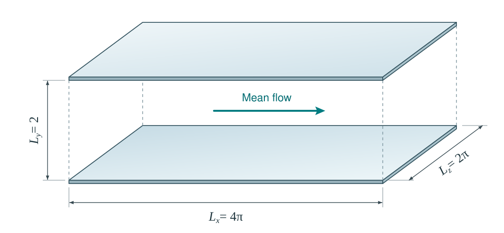
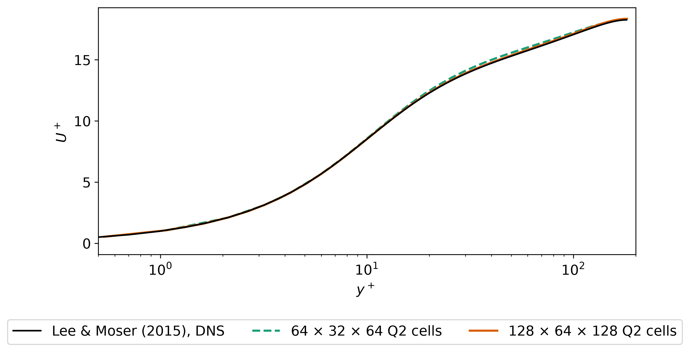
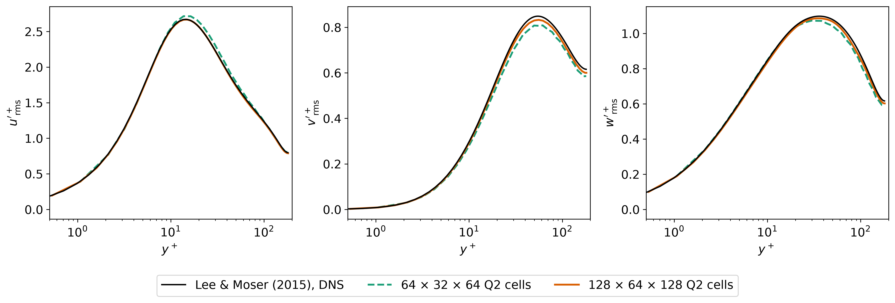
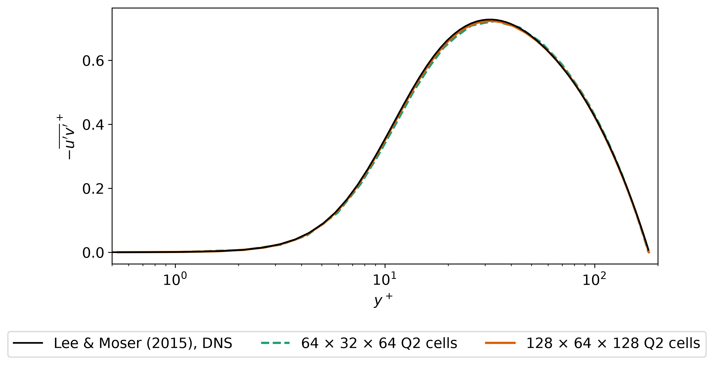

=======================================
Turbulent Channel Flow at Re_τ = 180
=======================================

The turbulent flow between two parallel walls is the canonical benchmark of wall-bounded turbulence. Direct numerical simulations (DNS) at a friction Reynolds number :math:`\mathrm{Re}_\tau \approx 180` [#kim1987]_ [#moser1999]_ [#lee2015]_ provide reference statistics (mean velocity, Reynolds stresses) for scale-resolving simulations. This example simulates this flow with the matrix-free solver of Lethe and Q2-Q2 elements, and shows that the statistics converge towards those of the DNS as the mesh is refined.

---------
Features
---------

- Solver: ``lethe-fluid-matrix-free`` (with Q2-Q2)
- Transient problem with an adaptive time step (CFL = 1)
- PSPG/SUPG stabilization
- Periodic boundary conditions and flow control at a constant bulk velocity
- Time-averaged velocity and Reynolds stresses
- Mesh stretched towards the walls, generated with a Python script
- Post-processing with a Python script: comparison with the DNS of Lee and Moser [#lee2015]_

----------------------------
Files Used in This Example
----------------------------

All files mentioned below are located in the example's folder (``examples/incompressible-flow/3d-turbulent-channel-Re-180``).

- Mesh generation script: ``channel_mesh.py``
- Parameter file: ``channel.prm``
- Post-processing script: ``channel_postprocessing.py``
- Reference data of the DNS of Lee and Moser [#lee2015]_: ``reference/LM_Channel_0180_mean_prof.dat`` and ``reference/LM_Channel_0180_vel_fluc_prof.dat``

-----------------------
Description of the Case
-----------------------

The fluid flows in the :math:`x` direction between two walls at :math:`y = -\delta` and :math:`y = \delta`. The domain is periodic in the streamwise (:math:`x`) and spanwise (:math:`z`) directions, with lengths :math:`L_x = 4\pi\delta` and :math:`L_z = 2\pi\delta`:

With the channel half-height :math:`\delta = 1`, the bulk velocity :math:`U_b = 1` and the kinematic viscosity :math:`\nu = 3.5 \times 10^{-4}`, the bulk Reynolds number is

.. math::

  \mathrm{Re}_b = \frac{U_b \delta}{\nu} = 2857

which is the one of the DNS of Lee and Moser [#lee2015]_. The flow then reaches a friction Reynolds number

.. math::

  \mathrm{Re}_\tau = \frac{u_\tau \delta}{\nu} = 182.1, \qquad u_\tau = \sqrt{\frac{\tau_w}{\rho}}

where :math:`\tau_w` is the mean wall shear stress and :math:`u_\tau` the friction velocity. Near the wall, the statistics are expressed in wall units: :math:`y^+ = y u_\tau / \nu` (with :math:`y` the distance to the wall), :math:`U^+ = U / u_\tau` and :math:`\overline{u'_i u'_j}^+ = \overline{u'_i u'_j} / u_\tau^2`. In these units, one wall unit is :math:`\delta / 182` here.

The domain must hold the largest turbulent structures: the near-wall streaks are about 100 wall units apart and up to about 1000 wall units long, and the motions of the outer region are longer still. The :math:`4\pi\delta \times 2\delta \times 2\pi\delta` box used here (:math:`2288 \times 1144` wall units in :math:`x` and :math:`z`) is that of Kim, Moin and Moser [#kim1987]_. The often-used :math:`2\pi\delta \times 2\delta \times \pi\delta` box (:math:`1144 \times 572` wall units) truncates the longest and widest motions, while Lee and Moser [#lee2015]_ use an even larger :math:`8\pi\delta \times 2\delta \times 3\pi\delta` box.

Since the domain is periodic, there is no inlet to drive the flow. A uniform body force :math:`\beta` in the :math:`x` direction plays the role of the mean pressure gradient: the flow control of Lethe adjusts it at each time step to keep the bulk velocity at :math:`U_b = 1`. Once the flow is statistically steady, the force balance over the domain gives :math:`\beta \delta = \tau_w / \rho = u_\tau^2`, so the time average of :math:`\beta` gives the friction velocity of the simulation.

The simulation starts from a flat mean profile with a bulk velocity of 1, perturbed by divergence-free waves, and becomes turbulent within a few tens of time units :math:`\delta/U_b`. Once the flow is statistically steady, the velocity and the Reynolds stresses are averaged in time from :math:`t = 100\, \delta/U_b` to the end of the simulation (:math:`t = 301\, \delta/U_b`). These time averages are then averaged over the :math:`x`-:math:`z` planes and over the two halves of the channel.

--------------
Parameter File
--------------

Simulation Control
~~~~~~~~~~~~~~~~~~

.. code-block:: text

  subsection simulation control
    set method                         = bdf2
    set adapt time step to respect CFL = true
    set max cfl                        = 1
    set end control                    = time
    set time step                      = 0.01
    set time end                       = 301
    set output name                    = channel
    set output path                    = ./output/
    set output control                 = time
    set output time frequency          = 50
    # Write each Q2 cell as 2x2x2 sub-cells, so the output holds every node.
    set subdivision = 2
  end

The second-order backward differentiation formula (``bdf2``) is used with a time step adapted to keep the CFL number at 1; the ``time step`` value is only used for the first iteration. On the mesh of this example, the time step settles at :math:`\Delta t \approx 0.042\, \delta/U_b`, or :math:`\Delta t^+ = \Delta t\, u_\tau^2/\nu \approx 0.5`. The results are written every 50 time units in the ``output`` folder. With ``subdivision = 2``, each Q2 cell is written as :math:`2 \times 2 \times 2` sub-cells whose vertices are the nodes of the cell, so the post-processing script has the value at every node.

FEM
~~~

.. code-block:: text

  subsection FEM
    set velocity degree = 2
    set pressure degree = 2
  end

Second-order (Q2) elements are used for both velocity and pressure.

Mesh
~~~~

.. code-block:: text

  subsection mesh
    set type               = dealii
    set grid type          = subdivided_hyper_rectangle
    set grid arguments     = 0.39269908169872414,...;0.023497296183941141,...;0.19634954084936207,... : 0, -1, 0 : 12.566370614359172, 1, 6.2831853071795862 : true
    set initial refinement = 1
  end

The mesh is a deal.II ``subdivided_hyper_rectangle`` with given step sizes in each direction (the lists are shortened above). The cells are uniform in :math:`x` and :math:`z`, and stretched towards the walls in :math:`y` with a hyperbolic tangent law:

.. math::

  y_j = \frac{\tanh\left(\gamma \left(2 j / n_y - 1\right)\right)}{\tanh \gamma}, \qquad j = 0, \ldots, n_y

with :math:`\gamma = 2`. The ``colorize = true`` argument (the last one) gives the boundary ids 0 and 1 to the faces at :math:`x = 0` and :math:`x = L_x`, 2 and 3 to the walls, and 4 and 5 to the faces at :math:`z = 0` and :math:`z = L_z`.

The grid arguments are generated by the script ``channel_mesh.py``. It writes them into the parameter file and prints the resolution of the mesh in the wall units of the DNS for each refinement:

.. code-block:: text
  :class: copy-button

  python3 channel_mesh.py --prm channel.prm

.. code-block:: text

  Q2 nodes in the wall units of Re_tau = 182.088 (node spacing = cell size / 2):
    refinement  cells          DoFs (u, p)  first node y+  center cell y+  dx+    dz+
             0  32x16x32           540,672           2.14            46.3   35.8   17.9
             1  64x32x64         4,259,840           1.07            23.1   17.9    8.9
             2  128x64x128      33,816,576           0.53            11.6    8.9    4.5

The coarse mesh has :math:`32 \times 16 \times 32` cells, and ``initial refinement = 1`` gives the :math:`64 \times 32 \times 64` mesh of this example (131,072 cells, about 4.3 million degrees of freedom): its first node off the wall is at :math:`y^+ \approx 1.1` and its node spacings are :math:`\Delta x^+ \approx 18` and :math:`\Delta z^+ \approx 9`. With ``initial refinement = 2``, every cell is halved again: the :math:`128 \times 64 \times 128` mesh (about 34 million degrees of freedom) has node spacings :math:`\Delta x^+ \approx 9` and :math:`\Delta z^+ \approx 4.5`, similar to the grid spacings of the spectral DNS of Kim, Moin and Moser [#kim1987]_ (:math:`\Delta x^+ \approx 12`, :math:`\Delta z^+ \approx 7`). The results below compare the two meshes. The options ``--cells``, ``--gamma``, ``--lx`` and ``--lz`` of the script change the coarse mesh.

Initial Conditions
~~~~~~~~~~~~~~~~~~

.. code-block:: text

  subsection initial conditions
    set type = nodal
    subsection uvwp
      set Function constants  = A1=0.05, a1=0.5, b1=4, A3=0.1, a3=2, b3=1
      set Function expression = 9/8*(1-y^8) - A3*4*y*(1-y*y)*sin(a3*x)*cos(b3*z); A1*b1*(1-y*y)^2*cos(b1*z)*cos(a1*x) - A3*a3*(1-y*y)^2*cos(a3*x)*cos(b3*z); A1*4*y*(1-y*y)*sin(b1*z)*cos(a1*x); 0
    end
  end

The mean profile :math:`\frac{9}{8}\left(1 - y^8\right)` is flat in the core, like a turbulent profile, and has a bulk velocity of exactly 1. It is perturbed by :math:`\mathbf{u}' = \nabla \times \left(\psi_x, 0, \psi_z\right)` with

.. math::

  \psi_x = A_1 f(y) \sin(b_1 z) \cos(a_1 x), \qquad \psi_z = A_3 f(y) \sin(a_3 x) \cos(b_3 z), \qquad f(y) = \left(1 - y^2\right)^2

The perturbation is divergence-free and vanishes at the walls. The wave numbers :math:`a_1 = 0.5` and :math:`b_3 = 1` make the perturbation periodic on the whole domain but not on a :math:`2\pi\delta \times \pi\delta` sub-box, so that the flow does not remain locked to a repetition of a smaller box.

Physical Properties
~~~~~~~~~~~~~~~~~~~

.. code-block:: text

  subsection physical properties
    set number of fluids = 1
    subsection fluid 0
      set kinematic viscosity = 3.5e-4
    end
  end

The kinematic viscosity sets :math:`\mathrm{Re}_b = 1/\nu = 2857`.

Boundary Conditions
~~~~~~~~~~~~~~~~~~~

.. code-block:: text

  subsection boundary conditions
    set number                = 4
    set fix pressure constant = true
    subsection bc 0
      set type               = periodic
      set id                 = 0
      set periodic id        = 1
      set periodic direction = 0
    end
    subsection bc 1
      set type = noslip
      set id   = 2
    end
    subsection bc 2
      set type = noslip
      set id   = 3
    end
    subsection bc 3
      set type               = periodic
      set id                 = 4
      set periodic id        = 5
      set periodic direction = 2
    end
  end

The faces normal to :math:`x` and to :math:`z` are periodic and the walls are no-slip. Since no boundary sets the pressure, ``fix pressure constant = true`` removes its constant mode.

Flow Control
~~~~~~~~~~~~

.. code-block:: text

  subsection flow control
    set enable            = true
    set inlet boundary id = 0
    set average velocity  = 1
    set flow direction    = 0
    set initial beta      = 4.06e-3
    set verbosity         = verbose
  end

The flow control keeps the average velocity through the periodic face of id 0 at 1 in the :math:`x` direction. The ``initial beta`` is :math:`u_\tau^2/\delta` of the DNS, so that the flow control starts close to its final value. With ``verbosity = verbose``, the bulk velocity and :math:`\beta` are printed at every time step; the post-processing script reads :math:`\beta` from this output to compute :math:`u_\tau`.

Post-processing
~~~~~~~~~~~~~~~

.. code-block:: text

  subsection post-processing
    set verbosity                         = verbose
    set calculate kinetic energy          = true
    set calculate enstrophy               = true
    set calculate average velocities      = true
    set initial time for average velocity = 100
  end

The time averages of the velocity and of the Reynolds stresses start at :math:`t = 100`, well after the transition (the enstrophy settles after :math:`t \approx 50`). They are written in the ``.vtu`` files with the instantaneous fields. The kinetic energy and the enstrophy of the domain are written at every time step in ``output/kinetic_energy.dat`` and ``output/enstrophy.dat``. The ``forces`` subsection of the parameter file writes the force on each boundary in ``output/force.<id>.dat``; those on the walls (ids 2 and 3) give the wall shear stress.

Non-linear Solver
~~~~~~~~~~~~~~~~~

.. code-block:: text

  subsection non-linear solver
    subsection fluid dynamics
      set tolerance            = 1e-5
      set reuse preconditioner = true
      set verbosity            = verbose
    end
  end

With a tolerance of :math:`10^{-5}`, the Newton solver does two iterations per time step and ends with a residual of about :math:`6 \times 10^{-7}`. With ``reuse preconditioner = true``, the multigrid preconditioner built at the first iteration is reused at the second, which saves one setup per time step. Only the preconditioner is reused: the residual and the Jacobian are evaluated at the current iterate, so the converged solution is unchanged.

Linear Solver
~~~~~~~~~~~~~

.. code-block:: text

  subsection linear solver
    subsection fluid dynamics
      set verbosity          = verbose
      set method             = gmres
      set max iters          = 200
      set max krylov vectors = 200
      set relative residual  = 1e-4
      set minimum residual   = 1e-7
      set preconditioner     = gcmg

      # Multigrid parameters. hp: the coarsest level is Q1 on the coarse mesh.
      set mg verbosity                   = quiet
      set mg enable hessians in jacobian = false
      set mg coarsening type             = hp

      # Smoother
      set mg smoother iterations     = 5
      set mg smoother eig estimation = true

      # Eigenvalue estimation parameters
      set eig estimation smoothing range = 5
      set eig estimation cg n iterations = 20
      set eig estimation verbosity       = quiet

      # Coarse-grid solver: one AMG cycle (a direct solve is far too slow).
      set mg coarse grid solver = amg
    end
  end

The linear systems are solved with GMRES preconditioned by a global coarsening multigrid (``gcmg``). With ``mg coarsening type = hp``, the levels first coarsen the mesh down to the coarse mesh, then lower the polynomial degree from 2 to 1. The coarsest level (Q1 on the :math:`32 \times 16 \times 32` mesh) is solved with one AMG cycle. GMRES takes about 20 iterations per solve. The other parameters are explained in :doc:`../../../parameters/cfd/linear_solver_control`.

Restart
~~~~~~~

.. code-block:: text

  subsection restart
    set checkpoint = true
    set frequency  = 2000
    set filename   = restart
    set restart    = false
  end

A checkpoint is written every 2000 time steps. If the simulation stops before its end (e.g., at the time limit of a job on a cluster), it resumes from the last checkpoint with ``restart = true``. The time averages are saved in the checkpoint and resume with it.

----------------------
Running the Simulation
----------------------

The simulation is launched in parallel with the ``lethe-fluid-matrix-free`` executable. Its standard output must be saved in ``log.txt``, since the post-processing script reads the flow-control force :math:`\beta` from it:

.. code-block:: text
  :class: copy-button

  mpirun -np 192 lethe-fluid-matrix-free channel.prm | tee log.txt

.. warning::

  This simulation must be run on a cluster. On the :math:`64 \times 32 \times 64` mesh of the parameter file, it took 3.7 hours on 192 cores (one node of two Intel Xeon 6972P), for about 7,200 time steps. On the :math:`128 \times 64 \times 128` mesh (``initial refinement = 2``), it took 28.5 hours on 384 cores (two nodes of two AMD EPYC 9654), for about 14,600 time steps. To try the case on a workstation, reduce ``time end``, or use the coarse mesh (``initial refinement = 0``), which is too coarse to give accurate statistics.

Once the simulation is over, the post-processing script compares the statistics with the DNS of Lee and Moser [#lee2015]_. It needs ``numpy`` and ``matplotlib``. In the folder of the simulation:

.. code-block:: text
  :class: copy-button

  python3 channel_postprocessing.py

The script first extracts the profiles of each snapshot that holds statistics (written at :math:`t \ge 101`): it averages the time-averaged fields of the ``.vtu`` files over the :math:`x`-:math:`z` planes, folds them onto one half of the channel, and writes them in ``output/profiles_<time>.tsv``. ``python3 channel_postprocessing.py extract`` only does this extraction: it can be run on the cluster, so that only these small files need to be copied, rather than the ``.vtu`` files (2.6 GB on the mesh of this example, 21 GB on the finer one). The script then reads :math:`\beta` from ``log.txt``, averages it over the averaging window of the last snapshot to obtain :math:`u_\tau = \sqrt{\overline{\beta} \delta}`, and plots the last profiles in wall units against those of the DNS. Several simulations are compared by giving their folders:

.. code-block:: text
  :class: copy-button

  python3 channel_postprocessing.py coarse fine --label "64 × 32 × 64" "128 × 64 × 128"

The script also prints :math:`\mathrm{Re}_\tau` and the errors on the skin friction coefficient :math:`C_f = 2 \tau_w / (\rho U_b^2)` and on the profiles.

----------------------
Results and Discussion
----------------------

The results of the :math:`64 \times 32 \times 64` mesh of the parameter file are compared with those of the :math:`128 \times 64 \times 128` mesh obtained with ``initial refinement = 2``. The two simulations were averaged over the same window, :math:`t = 100` to :math:`300`, or 200 time units :math:`\delta / U_b`.

The mean velocity agrees with the DNS on both meshes, in the viscous sublayer (:math:`U^+ = y^+`), the buffer layer and the logarithmic region:

The root-mean-square velocity fluctuations are more sensitive to the resolution. On the :math:`64 \times 32 \times 64` mesh, the peak of :math:`u'_\mathrm{rms}` is slightly too high, and those of :math:`v'_\mathrm{rms}` and :math:`w'_\mathrm{rms}` are too low: the under-resolved simulation puts too much of the turbulent kinetic energy in the streamwise component. Refinement moves the three components towards the DNS:

The Reynolds shear stress :math:`-\overline{u'v'}^+` agrees with the DNS on both meshes. In a statistically steady channel, the mean momentum balance fixes the total shear stress, :math:`-\overline{u'v'}^+ + \mathrm{d}U^+/\mathrm{d}y^+ = 1 - y/\delta`, so this profile depends mostly on :math:`\mathrm{Re}_\tau`:

The script prints the friction Reynolds number and the errors against the DNS. :math:`C_f` is computed from :math:`u_\tau`, and the error on :math:`U^+` is the relative :math:`L^2` error over the half-channel:

.. list-table::
   :header-rows: 1
   :widths: 22 10 10 10 10 10 10 10 10

   * - Mesh
     - :math:`\mathrm{Re}_\tau`
     - :math:`C_f`
     - :math:`U_c^+`
     - :math:`U^+` (:math:`L^2`)
     - :math:`u'^+_\mathrm{rms}` peak
     - :math:`v'^+_\mathrm{rms}` peak
     - :math:`w'^+_\mathrm{rms}` peak
     - :math:`-\overline{u'v'}^+` peak
   * - :math:`64 \times 32 \times 64`
     - 180.7
     - −1.5 %
     - +0.2 %
     - 1.1 %
     - +1.6 %
     - −4.8 %
     - −2.3 %
     - −0.6 %
   * - :math:`128 \times 64 \times 128`
     - 181.5
     - −0.7 %
     - +0.5 %
     - 0.4 %
     - −0.2 %
     - −1.9 %
     - −1.1 %
     - −0.6 %
   * - DNS [#lee2015]_
     - 182.1
     -
     -
     -
     -
     -
     -
     -

Even on the :math:`64 \times 32 \times 64` mesh (:math:`\Delta x^+ \approx 18`, :math:`\Delta z^+ \approx 9`), the skin friction is within 1.5 % of the DNS and the mean velocity within about 1 %. Refining the mesh halves the error on the skin friction, divides the error on the mean velocity by almost three, and brings the peaks of the three rms velocities within 2 % of the DNS. The largest remaining error is on the peak of :math:`v'_\mathrm{rms}`, the wall-normal component. The averages over 200 time units still carry a statistical uncertainty: the profiles change by up to 0.6 % between consecutive snapshots, 50 time units apart, and the mean velocities of the two halves of the channel differ by up to 0.5 % of the centerline velocity. Differences below about 0.5 % between the two meshes, such as on :math:`U_c^+` and on the peak of the Reynolds shear stress, are within this uncertainty.

----------------------------
Possibilities for Extension
----------------------------

- **Box size**: run the case in the smaller :math:`2\pi\delta \times 2\delta \times \pi\delta` box (``python3 channel_mesh.py --cells 16 16 16 --lx 6.283185307179586 --lz 3.141592653589793 --prm channel.prm``, with the same cell sizes) and observe the effect of the truncation of the large-scale motions on the statistics.
- **Polynomial degree**: compare Q1-Q1 and Q2-Q2 elements with the same number of nodes (Q1 elements on the mesh refined once more), or try Q3-Q3 elements.
- **Higher Reynolds numbers**: Lee and Moser [#lee2015]_ also give the statistics at :math:`\mathrm{Re}_\tau \approx 550`, 1000, 2000 and 5200. The number of cells grows roughly as :math:`\mathrm{Re}_\tau^3` at a fixed resolution in wall units.
- **Longer averaging**: average the statistics over a longer window to reduce their statistical uncertainty.

----------
References
----------

.. [#kim1987] \J. Kim, P. Moin, and R. Moser, “Turbulence statistics in fully developed channel flow at low Reynolds number,” *J. Fluid Mech.*, vol. 177, pp. 133–166, Apr. 1987, doi: `10.1017/S0022112087000892 <https://doi.org/10.1017/S0022112087000892>`_\.

.. [#moser1999] \R. D. Moser, J. Kim, and N. N. Mansour, “Direct numerical simulation of turbulent channel flow up to Re_τ = 590,” *Phys. Fluids*, vol. 11, no. 4, pp. 943–945, Apr. 1999, doi: `10.1063/1.869966 <https://doi.org/10.1063/1.869966>`_\.

.. [#lee2015] \M. Lee and R. D. Moser, “Direct numerical simulation of turbulent channel flow up to Re_τ ≈ 5200,” *J. Fluid Mech.*, vol. 774, pp. 395–415, Jul. 2015, doi: `10.1017/jfm.2015.268 <https://doi.org/10.1017/jfm.2015.268>`_\.
