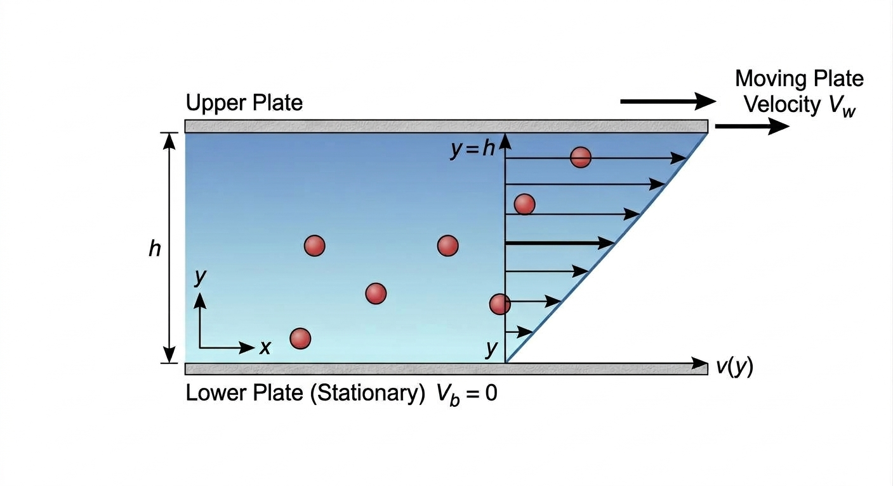
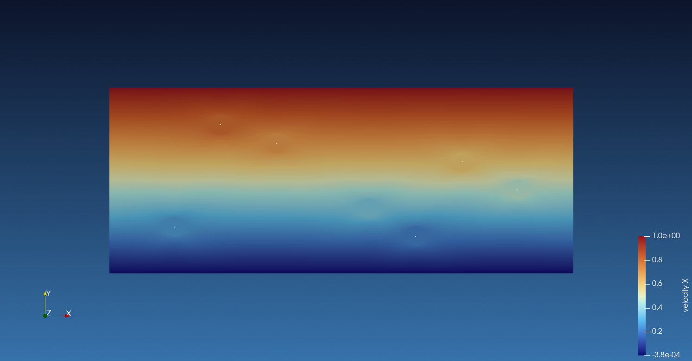
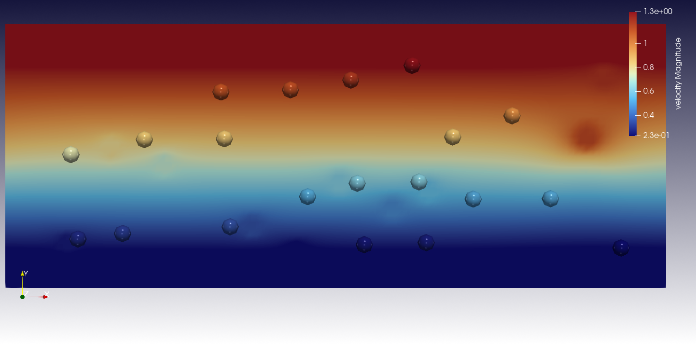
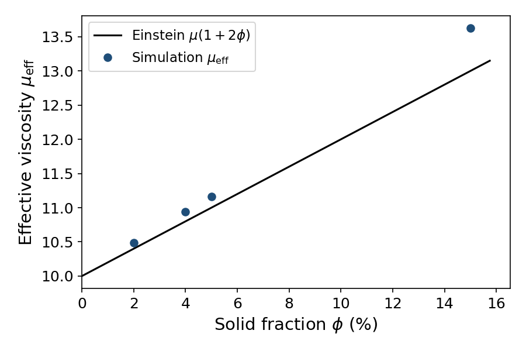
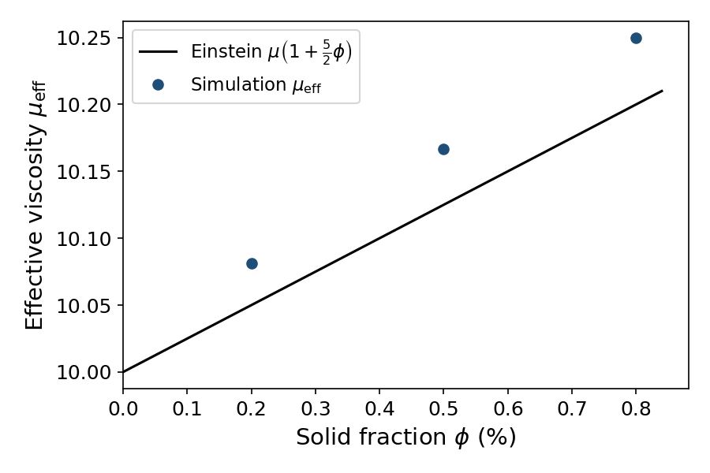
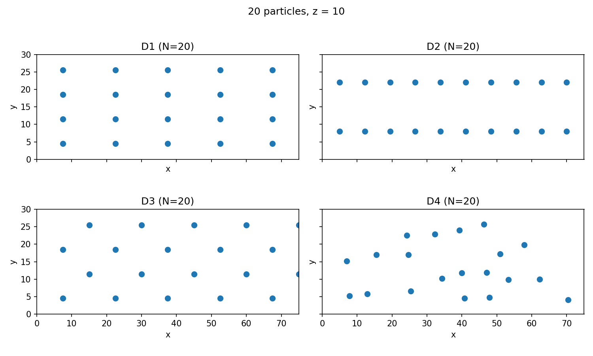

====================================
Couette Flow with Immersed Particles
====================================

This example tests Einstein's dilute viscosity on a Couette flow with rigid
particles, in two and three dimensions. The wall shear force is compared with
:math:`\mu(1 + 2\phi)` in two dimensions [#brady1984]_ and with
:math:`\mu(1 + \tfrac{5}{2}\phi)` in three dimensions [#einstein1906]_,
[#einstein1911]_. The comparison shows where those formulae are sufficient,
and where the measured viscosity departs from them. A short overview of
Einstein's viscosity law for dilute suspensions is given in
[#wikieinstein]_.

----------------------------------
Features
----------------------------------

- Solver: ``lethe-fluid-sharp``
- Couette flow in two and three dimensions
- Sharp-edge immersed boundary methods for static particles

---------------------------
Files Used in This Example
---------------------------

All files are in ``examples/sharp-immersed-boundary/couette-2d-3d``.

- Base 2D parameter file: ``couette-2d-7p.prm``
- Base 3D parameter file: ``couette-3d-20p.prm``
- 2D case generation Python script: ``epsilon_2d.py``
- 3D case generation Python script: ``epsilon_3d.py``
- Arrangement generation Python script: ``generate_arrangements_3d.py``
- 2D postprocessing Python script: ``plot_viscosity_2d.py``
- 3D postprocessing Python script: ``plot_viscosity_3d.py``

-----------------------
Description of the Case
-----------------------

A Newtonian fluid is sheared between a fixed plate and a plate moving at
constant speed :math:`U`. Without particles the velocity profile is linear
(Couette flow), :math:`u(y) = U y / h`, and the force on the moving plate is
known:

.. math::

   F_0 = \mu \frac{U A}{h},

where :math:`\mu` is the dynamic viscosity of the fluid, :math:`U` the speed
of the moving plate, :math:`h` the gap between the plates, :math:`y` the
coordinate normal to the plates measured from the fixed plate, and :math:`A`
the area of the plate in contact with the fluid. :math:`F_0` is the force
needed to keep the plate moving; the fluid exerts an equal and opposite force
on the plate.

Rigid particles are then placed in the gap. Each particle is given the
velocity of that linear profile at its center, so the particle follows the
fluid and does not slip. The plates feel an extra force. Einstein's theory
attributes it to the solid fraction :math:`\phi` [#einstein1906]_,
[#einstein1911]_. Essentially, this is caused by the disturbance in the
velocity field generated by the rigid particles, even in the absence of drag.

The relation is written with the intrinsic viscosity :math:`[\eta]`
[#wikiintrinsic]_:

.. math::
    \frac{\mu_{eff}}{\mu} = 1 + [\eta]\,\phi,
    \qquad
    [\eta] = 2 \text{ in 2D (discs)},
    \quad
    [\eta] = \tfrac{5}{2} \text{ in 3D (spheres)}.

This is a dilute result: particles interact with the flow, not with each
other. It is expected to be accurate at a few percent, and to drift once
:math:`\phi` is large. The coefficient :math:`5/2` was derived for spheres
[#einstein1906]_, [#einstein1911]_. The two-dimensional analogue for circular
discs is :math:`[\eta] = 2` [#brady1984]_. The force on the moving plate is
negative, because the fluid resists the motion. The effective viscosity
plotted in the figures is obtained from the absolute wall force,
:math:`\mu_{\mathrm{eff}} = \mu\,|F_x|/F_0`.

Two-Dimensional Channel
~~~~~~~~~~~~~~~~~~~~~~~

The channel is :math:`50 \times 20`. The bottom plate is fixed and the top
plate moves at speed 1. The streamwise direction is periodic. With
:math:`\mu = 10` the shear rate is :math:`1/20 = 0.05`, and the empty-channel
force is

.. math::
    F_{x,0} = 10 \times 0.05 \times 50 = 25.

Seven discs share one set of centers. Only the radius changes, from the
reference value 1 up to the value that produces :math:`\phi = 15\,\%`.

    Layout of the seven fixed discs used in the two-dimensional sweep.

========  ==========
Particle  Position
========  ==========
0         (7, 5)
1         (18, 14)
2         (28, 7)
3         (38, 12)
4         (12, 16)
5         (33, 4)
6         (44, 9)
========  ==========

The corresponding streamwise velocity field is nearly linear across the gap;
each disc leaves a localized disturbance around its center.

    Streamwise velocity for seven discs of radius 1. The Couette profile
    remains clear, with local perturbations around each particle.

Three-Dimensional Channel
~~~~~~~~~~~~~~~~~~~~~~~~~

The box is :math:`75 \times 30 \times 20`. The gap is 30 and the top plate
moves at 1.5, so the shear rate is again 0.05. A box of
:math:`50 \times 20 \times 20` would match the two-dimensional channel with an
extruded depth, but the twenty midplane centers used here need a larger
streamwise period, and the gap is kept at 30 so that the same shear rate is
obtained with a top-wall speed of 1.5. The empty-channel force is

.. math::
    F_{x,0} = 10 \times 0.05 \times 75 \times 20 = 750.

Twenty spheres of radius 1 sit at random midplane centers (:math:`z = 10`)
and fill :math:`\phi \approx 0.186\,\%` of the volume. The same centers cannot
exceed about :math:`1\,\%` without overlapping, so the radius sweep is limited
to :math:`0.2\,\%`, :math:`0.5\,\%` and :math:`0.8\,\%`. Those runs use weak
imposition of the plates (``function_weak``, ``beta = 10``).

    Velocity magnitude in the three-dimensional Couette channel with twenty
    fixed spheres of radius 1. The background shear is nearly linear; the
    spheres disturb the local velocity field.

----------------------
Parameter File
----------------------

``couette-2d-7p.prm`` is a steady solve at :math:`\mu = 10`.
``epsilon_2d.py`` changes only the radius, the output name and the force name.
The same structure is used in three dimensions, starting from
``couette-3d-20p.prm`` and ``epsilon_3d.py``.

Mesh
~~~~

The two-dimensional grid is a rectangle of :math:`50 \times 20`, colored so
that each side receives a boundary id.

.. code-block:: text

    subsection mesh
      set type               = dealii
      set grid type          = subdivided_hyper_rectangle
      set grid arguments     = 25,10 : 0,0 : 50,20 : true
      set initial refinement = 2
    end

In three dimensions the same construction is used on
:math:`75 \times 30 \times 20`, with
``grid arguments = 25,10,10 : 0,0,0 : 75,30,20 : true``.
The extra periodic direction in :math:`z` is what requires the third pair of
grid arguments.

Boundary Conditions
~~~~~~~~~~~~~~~~~~~

The streamwise direction is periodic. The plates are imposed weakly, with
``beta = 10``.

.. code-block:: text

    subsection boundary conditions
      set number = 3
      subsection bc 0
        set id                 = 0
        set type               = periodic
        set periodic id        = 1
        set periodic direction = 0
      end
      subsection bc 1
        set id   = 2
        set type = function_weak
        subsection u
          set Function expression = 0
        end
        subsection v
          set Function expression = 0
        end
        set beta = 10
      end
      subsection bc 2
        set id   = 3
        set type = function_weak
        subsection u
          set Function expression = 1
        end
        subsection v
          set Function expression = 0
        end
        set beta = 10
      end
    end

In three dimensions a second periodic pair is added in :math:`z` (ids 4 and 5,
direction 2), and the top-wall speed is 1.5 so that the shear rate remains
:math:`0.05`. The plates still use ``function_weak`` with ``beta = 10``.

Particles
~~~~~~~~~

The Navier–Stokes equations are not assembled inside the discs. Motion is
prescribed, and each disc receives the linear profile :math:`(y/20,\, 0)`.
The six other particles repeat this block at the centers listed above.

.. code-block:: text

    subsection particles
      set assemble Navier-Stokes inside particles = false
      set number of particles                     = 7
      subsection extrapolation function
        set length ratio   = 2
        set stencil degree = 1
      end
      subsection local mesh refinement
        set initial refinement                = 4
        set refine mesh inside radius factor  = 0.7
        set refine mesh outside radius factor = 1.3
      end
      subsection particle info 0
        set type             = sphere
        set shape arguments  = 1
        set integrate motion = false
        subsection position
          set Function expression = 7; 5
        end
        subsection velocity
          set Function expression = y/20; 0
        end
      end
    end

In three dimensions ``number of particles`` is 20, ``stencil degree`` is 2,
and each sphere is placed in the midplane :math:`z = 10` with the Couette
velocity at its center. Twenty spheres are used so that a dilute
:math:`\phi` can still be reached without overlapping.

Mesh Adaptation
~~~~~~~~~~~~~~~

.. code-block:: text

    subsection mesh adaptation
      set type = adaptive
    end

In three dimensions this type is set to ``none``. The near-particle
refinement is applied once at the start of the run, which is enough for the
dilute 3D cases and avoids the cost of Kelly adaptation.

Forces
~~~~~~

Lethe writes one force file per boundary id. ``.02.dat`` is the bottom plate
(id 2) and ``.03.dat`` is the top plate (id 3).

.. code-block:: text

    subsection forces
      set verbosity             = verbose
      set calculate force       = true
      set calculate torque      = false
      set force name            = force_7p_eps0
      set output precision      = 10
      set calculation frequency = 1
      set output frequency      = 1
    end

In three dimensions the force name is ``force_20p_3d``.

--------------------------------
Generating the Parameter Files
--------------------------------

Using the following command:

.. code-block:: text

    python3 epsilon_2d.py

writes one parameter file per solid fraction
(:math:`\phi = 2\,\%`, :math:`4\,\%`, :math:`5\,\%` and :math:`15\,\%`),
with the matching particle radius, output name and force name.

The same applies in three dimensions with ``python3 epsilon_3d.py``
(:math:`\phi = 0.2\,\%`, :math:`0.5\,\%` and :math:`0.8\,\%`).
Four midplane layouts (D1–D4) are obtained with
``python3 generate_arrangements_3d.py``.

---------------------------
Running the Simulation
---------------------------

Once the files are created, the base cases are launched with:

.. code-block:: text

    mpirun -np 4 lethe-fluid-sharp couette-2d-7p.prm
    mpirun -np 4 lethe-fluid-sharp couette-3d-20p.prm

Each file written by the generation scripts is then run the same way.
A three-dimensional case takes about one minute on 4 MPI ranks. The
two-dimensional cases take longer because of the local refinement.

---------------
Postprocessing
---------------

A Python postprocessing script is provided for each geometry. It reads the
wall force of the solid-fraction sweep, builds
:math:`\mu_{\mathrm{eff}} = \mu\,|F_x|/F_0`, and writes the viscosity figure.

.. code-block:: text

    python3 plot_viscosity_2d.py
    python3 plot_viscosity_3d.py

The two-dimensional script compares the measured viscosity with
:math:`\mu(1+2\phi)`. The three-dimensional script uses :math:`F_0 = 750`
and :math:`\mu(1+\tfrac{5}{2}\phi)`.

-----------------------
Results and Discussion
-----------------------

The two-dimensional curve compares the measured viscosity with
:math:`\mu(1 + 2\phi)` [#brady1984]_.

    Effective viscosity of the two-dimensional sweep. The curve is
    :math:`\mu(1+2\phi)`.

The points stay close to the curve up to 5 %. At 15 % the simulation lies
above the curve, 13.626 against 13.000.

The three-dimensional curve uses the viscosity :math:`10\,|F_x|/750` from the
twenty-particle weak-wall sweeps at :math:`0.2\,\%`, :math:`0.5\,\%` and
:math:`0.8\,\%`.

    Effective viscosity of the twenty-particle three-dimensional sweep. The
    curve is :math:`\mu(1+\tfrac{5}{2}\phi)`.

The three points remain slightly above the Einstein line (10.081, 10.167 and
10.250 against 10.050, 10.125 and 10.200). The relative error stays below
0.5 %, which confirms the dilute formula for twenty spheres in this range.

Particle Arrangements
~~~~~~~~~~~~~~~~~~~~~

Einstein's formula depends on the solid fraction alone. To check that the
measured viscosity is not an artefact of one particular layout, four midplane
arrangements of twenty spheres (radius 1, :math:`z = 10`) were generated with
``generate_arrangements_3d.py``:

- D1: a regular :math:`5\times 4` grid;
- D2: two streamwise rows at :math:`y = 8` and :math:`y = 22`;
- D3: the same four rows as D1, with alternate rows staggered in :math:`x`;
- D4: a random set with a minimum centre-to-centre gap of 5 (seed 7).

All four cases use the same domain, the same weak wall conditions, and the
same particle Reynolds number :math:`Re = \dot\gamma R^{2}/\nu = 0.005`. Only
the :math:`(x,y)` centres change.

    Midplane centres for arrangements D1–D4. Every particle sits at
    :math:`z = 10`.

At :math:`\phi \approx 0.186\,\%`, the effective viscosities are 10.112 (D1),
10.097 (D2), 10.099 (D3) and 10.093 (D4), against Einstein's value 10.047. The
spread between arrangements is below 0.2 %. In the dilute limit the wall force
is therefore controlled by :math:`\phi`, not by the particle layout, as
expected from Einstein's theory.

Reynolds-Number Dependence
~~~~~~~~~~~~~~~~~~~~~~~~~~

Einstein's viscosity formula is derived in the Stokes regime. To check that
the present three-dimensional comparison remains in that regime, the
kinematic viscosity was varied on arrangement D4 while the twenty midplane
centres were held fixed. With a shear rate of 0.05 and a particle radius of
1, the particle Reynolds number is

.. math::
    Re = \frac{\dot\gamma R^{2}}{\nu} = \frac{0.05}{\nu}.

Four values of :math:`\nu` were used, so that :math:`Re` spans
:math:`[5\times 10^{-3},\,6\times 10^{-2}]`. The empty-channel force scales as
:math:`F_{x,0} = 75\,\nu`, and the effective viscosity is obtained from the
wall force as :math:`\mu_{\mathrm{sim}} = \nu\,|F_x|/F_{x,0}`.

Over this range the ratio :math:`\mu_{\mathrm{sim}}/\mu_{E}` stays close to
1.0045 (relative error about 0.45 %). No measurable Reynolds-number
dependence appears. The dilute Couette response is therefore consistent with
Einstein's Stokes assumption for arrangement D4.

-------------------------
Possibility for Extension
-------------------------

The present study stays in the dilute, Stokes regime. Several extensions
follow naturally from the runs already performed.

At higher solid fractions the two-dimensional viscosity lies above
:math:`\mu(1+2\phi)`. A quadratic closure
:math:`\mu_{eff}/\mu = 1 + 2\phi + k\phi^{2}` can be fitted on the
two-dimensional sweep, and the coefficient :math:`k` related to the minimum
gap between neighbouring particles.

The three-dimensional arrangements D1–D4 could be repeated at larger radius
(still below overlap) to see when configuration effects appear. The same
centres can also be extruded or shifted in :math:`z` to leave the midplane
constraint.

Finally, the Reynolds-number window can be pushed above
:math:`Re \sim 10^{-1}` on arrangement D4, where inertia is no longer
negligible, to map the departure from Einstein's Stokes prediction.

----------
References
----------

.. [#einstein1906] \A. Einstein, "Eine neue Bestimmung der Moleküldimensionen,"
   *Ann. Phys.*, vol. 324, no. 2, pp. 289–306, Feb. 1906, doi:
   `10.1002/andp.19063240204 <https://doi.org/10.1002/andp.19063240204>`_.

.. [#einstein1911] \A. Einstein, "Berichtigung zu meiner Arbeit: Eine neue
   Bestimmung der Moleküldimensionen," *Ann. Phys.*, vol. 339, no. 3,
   pp. 591–592, 1911, doi:
   `10.1002/andp.19113390313 <https://doi.org/10.1002/andp.19113390313>`_.

.. [#brady1984] J. F. Brady, "The Einstein viscosity correction in
   :math:`n` dimensions," *Int. J. Multiphase Flow*, vol. 10, no. 1,
   pp. 113–114, 1984, doi:
   `10.1016/0301-9322(83)90064-2 <https://doi.org/10.1016/0301-9322(83)90064-2>`_.

.. [#wikiintrinsic] "Intrinsic viscosity," *Wikipedia*. [Online]. Available:
   `https://en.wikipedia.org/wiki/Intrinsic_viscosity
   <https://en.wikipedia.org/wiki/Intrinsic_viscosity>`_.

.. [#wikieinstein] "Viscosity — Suspensions of particles," *Wikipedia*.
   [Online]. Available:
   `https://en.wikipedia.org/wiki/Viscosity#Suspensions_of_particles
   <https://en.wikipedia.org/wiki/Viscosity#Suspensions_of_particles>`_.