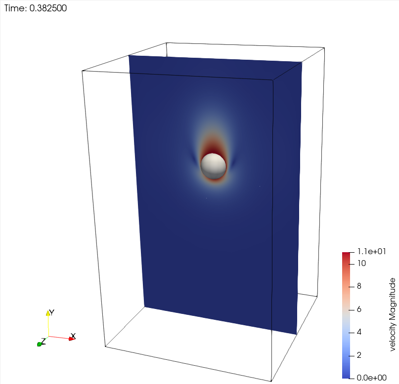
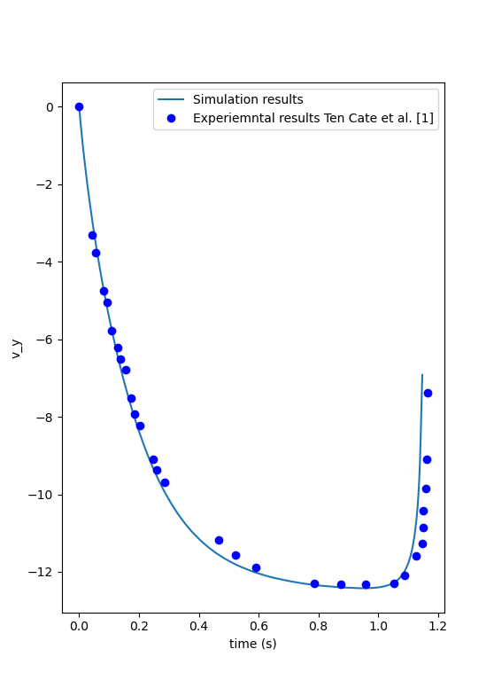

==============================================================================
Sedimentation of One Particle
==============================================================================

This example aims to numerically reproduce the results obtained by ten Cate `et al.` [#tencate2002]_ for the E4 experiment. This experiment measures the velocity of a 1.5 cm particle settling in a container filled with a viscous fluid. The container is small enough to affect the sedimentation of the particle.

.. warning::
    * This case is a computationally expensive example. It can take several hours to run on a desktop computer.

----------------------------------
Features
----------------------------------

- Solvers: ``lethe-fluid-sharp`` (with Q1-Q1)
- Transient problem
- Displays the capability of the resolved CFD-DEM solver for the flow around one particle

---------------------------
Files Used in This Example
---------------------------

All files mentioned below are located in the example's folder (``examples/sharp-immersed-boundary/sedimentation-1-particle``).

- Parameter file: ``sedimentation-1-particle.prm``
- Experimental velocity of ten Cate `et al.` [#tencate2002]_ for the E4 experiment, as digitized from the original figure of this documentation page: ``ten-cate-E4.dat``
- Postprocessing Python script: ``post-process-sedimentation-1-particle.py``

-----------------------
Description of the Case
-----------------------

The E4 experiment consists of the release of a particle made of Nylon (:math:`\rho_p=0.001120 \frac{\text{kg}}{\text{cm}^{3}}`) with a diameter of 1.5 cm. The center of the particle is located 12.75 cm above the bottom of a :math:`10 \times 16 \times 10` cm container. The viscosity of the fluid is :math:`\mu_f=0.00058 \frac{\text{kg}}{\text{s cm}}` which is equivalent to :math:`\mu_f=0.058 \frac{\text{N s}}{\text{m}^{2}}`. The density of the fluid is :math:`\rho_f=0.000960 \frac{\text{kg}}{\text{cm}^{3}}`. The gravitational acceleration is :math:`g= -981 \frac{\text{cm}}{\text{s}^{2}}`. The particle accelerates due to gravity until it reaches the bottom of the container, shortly after which the simulation ends.

.. note::
   You will note that we have transformed every length unit into centimeters. The reason is that the particle's size is very close to 1 cm. Representing the problem in this way helps the linear solver converge. It avoids extremely small values in the matrix due to the volume of cells being expressed in :math:`\text{cm}^{3}` instead of :math:`\text{m}^{3}`.

All the container walls have no-slip boundary conditions except at the top of the container, where we define an open boundary.

---------------
Parameter File
---------------

We explain every part of this parameter file in detail. In each section of the parameter file, we describe relevant parameters. The omitted parameters are only user preference parameters and do not impact the simulation results. For more detail, we suggest visiting the :doc:`../../../parameters/parameters`.

Simulation Control
~~~~~~~~~~~~~~~~~~~~~~~~~~~~~~
.. code-block:: text

    subsection simulation control
      set method             = bdf2
      set bdf startup method = multiple_step_bdf
      set time step          = 0.0025 # Time step
      set time end           = 1.3    # End time of simulation
      set output name        = out    # Prefix for VTU outputs
      set output path        = out/   # Folder of the outputs
      set output frequency   = 1      # Frequency of simulation output
      set subdivision        = 1      # Mesh subdivision when output end
    end

* The ``method`` is set to ``bdf2`` to have a second-order time-stepping method. This ensures a low error due to the time discretization in this case.

* The ``bdf startup method`` is set to ``multiple_step_bdf``, as we do not have an initial solution that allows us to generate previous time steps. We use a multiple step BDF approach that ramps up the order of the scheme in the first few time steps.

* The ``time step`` is set to 0.0025. This ensures a low error due to the time discretization for this case.

* The ``time end`` is set to 1.3. This is slightly longer than the experimental results of ten Cate `et al.` [#tencate2002]_. This ensures that the entire trajectory of the particle has been simulated.

Physical Properties
~~~~~~~~~~~~~~~~~~~~~~~~~~~~~~
.. code-block:: text

    subsection physical properties
      subsection fluid 0
        set kinematic viscosity = 0.6041666666666
        set density             = 0.000960
      end
    end

* The ``kinematic viscosity`` is set to 0.6041666666666. This value is derived from the case description by dividing :math:`\mu_f` by :math:`\rho_f`.

FEM
~~~
.. code-block:: text

    subsection FEM
      set velocity degree = 1
      set pressure degree = 1
    end

Here we use Q1-Q1 elements. This case is for demonstration purposes only; as such, we want a simulation that is not too costly to run.

Mesh
~~~~~~
.. code-block:: text

    subsection mesh
      set type               = dealii
      set grid type          = subdivided_hyper_rectangle
      set grid arguments     = 5,8,5: 0,0,0 : 10 , 16 ,10 : true
      set initial refinement = 1
    end

The domain is a rectangular box, so we can directly use a subdivided hyper rectangle mesh from the deal.II library. In this case, we have oriented the y-direction with gravity. As such, the long side of the box is along this axis.

* The ``grid arguments`` is set to ``5,8,5: 0,0,0 : 10 , 16 ,10 : true``. This argument has three parts. First, ``5,8,5`` describes the initial subdivision of the box. This subdivision has been chosen as it is the coarsest mesh of the box with cubic elements. Second, ``0,0,0 : 10 , 16 ,10`` gives the two opposite corners of the rectangular box, (0,0,0) and (10,16,10). Finally, ``true`` is a boolean that activates the colorization of the boundaries. This allows us to define separate boundary conditions at each side of the box.

* The ``initial refinement`` is set to 1. This gives a base mesh with cells that are a bit smaller than the particle.

Mesh Adaptation
~~~~~~~~~~~~~~~
.. code-block:: text

    subsection mesh adaptation
      # Fraction of coarsened elements
      set fraction coarsening = 0.3

      # Fraction of refined elements
      set fraction refinement = 0.05

      # How the fraction of refinement/coarsening are interpreted. Choices are
      # <number|fraction>.
      set fraction type = number

      # Frequency of the mesh refinement
      set frequency = 1

      # Maximum number of elements
      set max number elements = 750000

      # Maximum refinement level
      set max refinement level = 6
      # minimum refinement level
      set min refinement level = 0

      # Type of mesh adaptationChoices are <none|uniform|adaptive>.
      set type            = adaptive
      set error estimator = kelly

      # Variable for kelly estimationChoices are <velocity|pressure>.
      set variable = velocity
    end

* The ``fraction coarsening`` is set to 0.3. This limits the accumulation of elements when the particle is moving. It allows the cells to be coarsened once the particle has moved away from them.

* The ``fraction refinement`` is set to 0.05. The objective here is to refine elements that become close to the particle when it's moving. This will mostly refine elements around the particle that are not included in the refinement zone around the particle. The refinement zone around the particle will be discussed in more detail in the IB particle section.

* The ``frequency`` is set to 1. Since the particle is moving at each time step, the refinement zone around it should be reevaluated at each time step.

* The ``max refinement level`` is set to 6. This parameter limits how small the elements around the particle can get, which limits the total number of elements in the problem. Here we limit the mesh size to 48 elements per diameter of the particle. This should be sufficient to get accurate results.

* The ``type`` is set to ``adaptive``. Since the particle is moving and we do not want a uniform refinement of all the cells, we use the ``kelly`` error estimator based on the ``velocity`` variable.

Boundary Conditions
~~~~~~~~~~~~~~~~~~~
.. code-block:: text

    subsection boundary conditions
      set number = 6
      subsection bc 0
        set id   = 0
        set type = noslip
      end
      subsection bc 1
        set id   = 1
        set type = noslip
      end

      subsection bc 2
        set id   = 2
        set type = noslip
      end
      subsection bc 3
        set id   = 4
        set type = noslip
      end
      subsection bc 4
        set id   = 5
        set type = noslip
      end
      subsection bc 5
        set id   = 3
        set type = outlet
        set beta = 0
      end
    end

Here we define a ``noslip`` boundary condition on the five walls of the box and an ``outlet`` on the boundary with ``id = 3``, which is the top of the box. We refer the reader to the :doc:`../../../parameters/cfd/boundary_conditions_cfd` section on how those boundaries are defined.

.. note::
    The boundary ids of a colorized deal.II rectangular mesh are numbered as follows: :math:`x_{min}=0`, :math:`x_{max}=1`, :math:`y_{min}=2`, :math:`y_{max}=3`, :math:`z_{min}=4`, :math:`z_{max}=5`.

Initial Conditions
~~~~~~~~~~~~~~~~~~
.. code-block:: text

    subsection initial conditions
      # Type of initial conditionChoices are <L2projection|viscous|nodal>.
      set type = nodal
      subsection uvwp
        set Function expression = 0; 0; 0;0
      end
    end

The initial condition for this case is simple to define. At the start of the simulation, we assume that the particle and the fluid are at rest. From there, we define a uniform velocity field of 0 everywhere. To do that, we use ``type = nodal`` and set the function expression to 0 for all the velocity components and the pressure.

Non-linear Solver
~~~~~~~~~~~~~~~~~

.. code-block:: text

    subsection non-linear solver
      subsection fluid dynamics
        set verbosity             = verbose
        set tolerance             = 1e-5
        set max iterations        = 10
        set force rhs calculation = true
      end
    end

* The ``tolerance`` is set to 1e-5. This is small enough to ensure that the flow field is adequately resolved, as we expect a velocity of the particle of the order of 10 cm/s.

* The ``max iterations`` is set to 10. The objective here is to allow enough Newton iterations to converge to the tolerance, while limiting the time spent on a single time step if the system is too stiff.

* The ``force rhs calculation`` is set to ``true``. This is the most important difference with most of the other examples. By default, the non-linear solver recalculates the RHS only after the update of the solution. Here, however, we need to evaluate it before every resolution of the linear system, and we cannot use the RHS evaluated after the previous Newton iteration, because the particle position was updated between these two steps. This means that the RHS is evaluated twice per Newton iteration. The non-linear solver follows this sequence of steps for each Newton iteration:

  * update the particle position
  * update the Jacobian matrix
  * update the RHS
  * solve the linear system
  * reevaluate the RHS to check the convergence

Linear Solver
~~~~~~~~~~~~~
.. code-block:: text

    subsection linear solver
      subsection fluid dynamics
        set method                                = gmres
        set max iters                             = 200
        set relative residual                     = 1e-5
        set minimum residual                      = 1e-11
        set preconditioner                        = ilu
        set ilu preconditioner fill               = 0
        set ilu preconditioner absolute tolerance = 1e-12
        set ilu preconditioner relative tolerance = 1.00
        set verbosity                             = verbose
        set max krylov vectors                    = 200
      end
    end

* The ``method`` is set to ``gmres``. This solver is less computationally expensive than the other options, and this case does not require any special preconditioner. This makes the ``gmres`` solver with an ``ilu`` preconditioner the best option available.

* The ``max iters`` is set to 200. This is more than the number of iterations needed to solve the system.

* The ``max krylov vectors`` is set to the same number as the maximum solver iterations. This ensures that we keep the full Arnoldi basis for each new iteration. From experience, keeping all the Krylov vectors results in a faster resolution for this case than clearing the basis after a certain number of ``gmres`` iterations.

* The ``relative residual`` is set to 1e-5. This is small enough to avoid under-resolving the linear system, which would cause extra non-linear iterations, while not requiring too many ``gmres`` iterations.

* The ``ilu preconditioner fill`` is set to 0. This is the cheapest option. In this case, we can use this option without having to do too many ``gmres`` iterations. It requires less computational time to do a few more ``gmres`` iterations than to build a more expensive preconditioner and do fewer ``gmres`` iterations.

IB Particles
~~~~~~~~~~~~~~
.. code-block:: text

    subsection particles
      set assemble Navier-Stokes inside particles = false
      set number of particles                     = 1
      subsection extrapolation function
        set length ratio   = 2
        set stencil degree = 3
      end

      subsection local mesh refinement
        set initial refinement                = 6
        set refine mesh inside radius factor  = 0.8
        set refine mesh outside radius factor = 1.3
      end

      subsection DEM
        set particle nonlinear tolerance = 1e-5
        subsection gravity
          set Function expression = 0;-981;0
        end
      end

      subsection particle info 0
        set type             = sphere
        set shape arguments  = 0.75
        set integrate motion = true
        subsection position
          set Function expression = 5;12.75;5
        end
        subsection velocity
          set Function expression = 0;0;0
        end

        subsection physical properties
          set density = 0.001120
        end
      end
    end

In this subsection, we define most of the parameters that are related to the particle.

* The ``number of particles`` is set to one as we only want one particle.

* ``stencil degree`` is set to 3, as this is the highest degree we can use in this case without leading to a Runge instability.

* ``refine mesh inside radius factor`` and ``refine mesh outside radius factor`` are set to 0.8 and 1.3. The cells that have a degree of freedom between 0.8 and 1.3 times the radius of the particle from its center are refined. This creates a refined shell around the surface of the particle that avoids having hanging nodes in the calculation and ensures a small enough mesh around the particle.

* ``initial refinement`` is set to 6. Here we want to have the mesh as small as possible for the first time step. To achieve this, we refine every element with at least one vertex in the refinement zone around the particle 6 times before the simulation starts. This ensures that all the cells in the refinement zone around the particle are as small as possible. This number of refinements is 1 more than necessary. This is to avoid having part of the particle not properly refined as the initial mesh is big enough that some elements cut by the IB may not be properly detected at the beginning of the process. Doing one more refinement ensures that all the elements are properly refined.

* ``integrate motion`` is set to true because we are interested in the dynamics of the particle as it sediments in the rectangular box.

* ``assemble Navier-Stokes inside particles`` is set to false because we are not interested in the flow inside of the particle.

* ``length ratio`` has been set to 2. This is small enough not to impact the conditioning of the matrix too much, while avoiding the interpolation of the immersed boundary stencil in multiple elements.

* ``particle nonlinear tolerance`` has been set to 1e-5. This is small enough to ensure that the particle dynamics are adequately resolved. We expect a velocity of the particle of the order of 10 cm/s.

* ``gravity`` ``Function expression`` is set to 0;-981;0 according to the definition of the case. As we chose the long axis of the rectangular box along the y-axis, we define gravity in this direction.

The following parameters are defined in the ``particle info 0`` subsection.

* ``position`` ``Function expression`` is set to 5;12.75;5. This is the initial position of the particle according to the description of the case.

* ``velocity`` ``Function expression`` is set to 0;0;0. This is the initial velocity of the particle since it starts at rest.

* ``shape arguments`` is set to 0.75, which is the radius of the sphere. This is according to the definition of the case where the particle has a diameter of 1.5 cm.

* ``density`` is set to 0.001120. This is according to the definition of the case.

-----------------------
Running the Simulation
-----------------------

Call ``lethe-fluid-sharp`` by invoking the following command:

.. code-block:: text
  :class: copy-button

  mpirun -np 16 lethe-fluid-sharp sedimentation-1-particle.prm

to run the simulation using sixteen CPU cores. Feel free to use more CPU cores.

.. warning::
    Make sure to compile Lethe in `Release` mode and run in parallel using mpirun.
    This simulation takes :math:`\sim \, 8` hours on :math:`16` processes.

---------------
Results
---------------

In this section, we will briefly show some results of this simulation.

First, we look at a slice of the velocity profile during the acceleration phase.

We can also compare the velocity of the particle in time with the measurements of ten Cate `et al.` [#tencate2002]_. A similar figure can be generated by launching the following command from the folder of the example, once the simulation is complete:

.. code-block:: text
  :class: copy-button

  python3 post-process-sedimentation-1-particle.py

This script reads the velocity of the particle in ``out/ib_force.00.dat`` and the experimental data in ``ten-cate-E4.dat``.

---------------
Reference
---------------

.. [#tencate2002] \A. ten Cate, C. H. Nieuwstad, J. J. Derksen, and H. E. A. Van den Akker, “Particle imaging velocimetry experiments and lattice-Boltzmann simulations on a single sphere settling under gravity,” *Phys. Fluids*, vol. 14, no. 11, pp. 4012–4025, Oct. 2002, doi: `10.1063/1.1512918 <https://doi.org/10.1063/1.1512918>`_\.

